<div align="center">

# civil-mcp

**Road design you can hand to an AI agent, and check.** 68 Civil 3D-style design tools served as a local MCP server. Every result cites the clause it was checked against, every call goes into a hash-chained audit log, and nothing leaves *PRELIMINARY* until a licensed engineer approves it.

[](https://github.com/reacherwu/civil-mcp/actions/workflows/ci.yml)
[](LICENSE)
[](https://www.rust-lang.org/)
[](https://modelcontextprotocol.io/)
[](#standards-coverage-by-country)


| **68** MCP tools | **288** design checks, **0** mandatory failures | **38**-sheet drawing set + **14**-sheet construction set | **351 / 351** independent re-checks within tolerance | **11** real-terrain runs on **9** surfaces |
|:---:|:---:|:---:|:---:|:---:|

<sub>Numbers come from a fresh run of the committed demo (US AASHTO profile, 50 km/h rural collector, 5,607 USGS 3DEP survey points near Palo Alto CA) and of `scripts/terrain_batch.py`, both on 2026-10-20 (PDT). Layered elastic pavement analysis matches the published KENPAVE example to ≤ 0.09 %.</sub>

**This is not a substitute for a licensed engineer.** It is a set of tools an engineer can direct, audit and approve. Current depth: concept / 30 % design content, laid out in a 60 %-style sheet format.

</div>

---

## Contents

[Status](#status-at-a-glance) · [Works with](#works-with-mcp-clients) · [How it works](#how-it-works) · [Why](#why) · [Quick start](#quick-start) · [Client setup](#mcp-client-setup) · [Feature gallery](#feature-gallery) · [Real terrain](#real-terrain-route-feasibility-and-switchbacks) · [Superelevation runoff](#superelevation-runoff-sized-during-alignment-design) · [Civil 3D handoff](#civil-3d-handoff-landxml-cross-sections-and-3d-cad-model) · [Design package](#design-package-v1) · [Construction set](#construction-scale-sheet-set) · [Blender](#blender-visualisation-concept--preliminary) · [Units](#units-si-or-us-customary) · [Drawing set](#drawing-set-all-38-sheets) · [Sheet frames](#sheet-frames-and-drafting-standards) · [Standards](#standards-coverage-by-country) · [Validation](#validation-summary) · [Deliverables](#deliverables-matrix) · [Status and limits](#status-and-limits) · [Roadmap](#roadmap) · [License](#license-and-attribution)

## Status at a glance

| Area | State |
|---|---|
| Design depth | Concept / 30 % content in a 60 %-style sheet format. Every sheet is stamped PRELIMINARY until an engineer approves |
| Standards profiles | US AASHTO, Canada TAC, UK DMRB, Australia Austroads, New Zealand Austroads + NZTA |
| Units | SI by default; switch to US customary (international or survey foot) and back at any time |
| Terrain | GeoTIFF / COG, ESRI ASCII grid, LAS / LAZ, with CRS handling; 11 real-terrain runs documented |
| Outputs | PDF, per-sheet DXF and SVG, LandXML 1.2 (metric or imperial) with cross sections, a versioned design package (JSON + LandXML), 3D DXF model, glTF / Blender scene, CSV / Markdown / HTML reports |
| Verification | 351 independent Python re-checks, CI on every push, Rust unit and pipeline tests |
| Not yet | built-in DWG writer (DWG needs ODA File Converter), a Civil 3D / 12d / BricsCAD open test, end-to-end tests in MCP clients, remote (HTTP) transport |

## Works with (MCP clients)

civil-mcp is a standard [Model Context Protocol](https://modelcontextprotocol.io/) server that uses the **local stdio transport**. Your AI tool starts it as a local program on your machine and exchanges JSON-RPC messages with it over stdin/stdout. Nothing is hosted, and no network port is opened. Any MCP-capable client that can launch a local command can use it after you add one config entry.

| Client | Where the entry goes (format checked against the official docs, 2026-10-20) | Status |
|---|---|---|
| [Claude Code](https://docs.claude.com/en/docs/claude-code/mcp) | `claude mcp add civil -- /path/to/civil-mcp` (writes `~/.claude.json`), or `.mcp.json` → `mcpServers` | per docs, not yet tested end to end |
| [Claude Desktop](https://modelcontextprotocol.io/docs/develop/connect-local-servers) | `claude_desktop_config.json` → `mcpServers` | per docs, not yet tested end to end |
| [Cursor](https://cursor.com/docs/context/mcp) | `.cursor/mcp.json` or `~/.cursor/mcp.json` → `mcpServers` | per docs, not yet tested end to end |
| [Codex](https://developers.openai.com/codex/mcp) (CLI / IDE extension / ChatGPT desktop app) | `codex mcp add civil -- /path/to/civil-mcp`, or `~/.codex/config.toml` → `[mcp_servers.civil]` | per docs, not yet tested end to end |
| [Gemini CLI](https://geminicli.com/docs/tools/mcp-server/) | `gemini mcp add civil /path/to/civil-mcp`, or `~/.gemini/settings.json` → `mcpServers` | per docs, not yet tested end to end |
| [VS Code (GitHub Copilot agent mode)](https://code.visualstudio.com/docs/copilot/customization/mcp-servers) | `MCP: Add Server` → *Command (stdio)*, or `.vscode/mcp.json` → `servers` | per docs, not yet tested end to end |
| Raw JSON-RPC over stdio | `initialize` → `tools/list` | **tested**: protocol `2024-11-05`, 68 tools listed. The CI test `crates/civil-mcp/tests/stdio.rs` drives a UK-profile session over stdio |

**What does not work yet**

- **Web-only clients** that can only reach a *remote* MCP server over HTTP / Streamable HTTP, for example ChatGPT on the web (plugins), claude.ai connectors and other browser-hosted agents. civil-mcp has no HTTP transport yet. That is first on the [roadmap](#roadmap).
- **Agents without MCP support.** You can still run the tools from Rust (`civil_core::tools::Session::call`), as the demo does.

## How it works

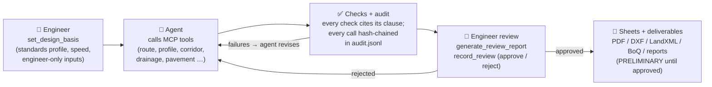

1. **The engineer sets the basis first.** They pick the standards profile and project inputs, and enter anything the profile refuses to default, such as copyrighted table values.
2. **The agent designs inside that basis.** It calls tools, reads the checks and revises. In the demo it re-sizes the storm network seven times and lowers the cover twice.
3. **Every call is logged.** `audit.jsonl` records inputs, outputs and SHA-256 hashes, chained like a ledger. `verify_audit_log` detects tampering.
4. **Only the engineer approves.** `record_review` requires an `engineer:<name>` actor. Until then, every sheet says *PRELIMINARY – NOT FOR CONSTRUCTION*.

## Why

- **Civil design software is slow and fragile at corridor scale.** Users report waiting on every operation for a 4-mile corridor ([r/civil3d](https://www.reddit.com/r/civil3d/comments/1ecojp2/cooridor_question/)), files that corrupt and TINs that fail after adding breaklines ([r/civilengineering](https://www.reddit.com/r/civilengineering/comments/13sjpp6/civil_3d_frustration/)), a highly upvoted thread on [why all civil modelling packages are so slow](https://www.reddit.com/r/civilengineering/comments/1kpexvz/why_are_seemingly_all_civil_modelling_packages_so/), and a corridor section editor that takes minutes to open ([Autodesk forum](https://forums.autodesk.com/t5/civil-3d-forum/corridor-section-editor-very-slow-to-open-and-close/td-p/12940839)).
- **AI design tools exist, but as black-box plug-ins** ([Allsite.ai](https://www.allsite.ai/), [drtwrk](https://drtwrk.io/), [RoadEng](https://www.softree.com/RoadEng)). civil-mcp is open, cites every clause, and is re-checked by independent code.
- **The law requires the engineer to stay in charge.** North Carolina [21 NCAC 56.0701](http://reports.oah.state.nc.us/ncac/title%2021%20-%20occupational%20licensing%20boards%20and%20commissions/chapter%2056%20-%20engineers%20and%20surveyors/21%20ncac%2056%20.0701.html) and Florida [FBPE](https://fbpe.org/regulation-in-the-ai-era/) require responsible charge. NSPE's [2025 discussion of AI](https://www.nspe.org/career-growth/pe-magazine/issue-3-2025/use-artificial-intelligence-engineer-practice) says that reviewing documents after preparation, without involvement in the design, "does not satisfy" responsible charge. So the workflow puts the engineer before the agent (the basis) and after it (approval), with the audit trail in between.

## Quick start

```bash
git clone https://github.com/reacherwu/civil-mcp && cd civil-mcp
cargo run --release -p civil-demo -- demo-out              # SI; a few seconds after the build
cargo run --release -p civil-demo -- demo-out-us --units us   # the same design in US customary units
```

<details><summary><b>What the demo writes to <code>demo-out/</code></b> (164 files plus the 12-file `design-package/` folder)</summary>

| Group | Files |
|---|---|
| Drawings | `sheets.pdf` (38 sheets), `sheet-01.dxf` … `sheet-38.dxf` + SVG, `model.dxf` |
| Construction set | `construction-set.pdf` (14 sheets), `cs-01.dxf` … `cs-14.dxf` + SVG, `construction-register.csv` |
| Model exchange | `design.xml` (LandXML 1.2: surfaces with FG breaklines and boundary, alignment, profiles, superelevation, cross sections, parcels, pipe networks), `design-package/` (manifest + 10 JSON files + LandXML), `civil3d-model.dxf` (3D), `corridor.json`, `setting-out.csv` |
| Visualisation | `scene.glb` (glTF 2.0), `scene.json`, `blender_scene.py` |
| Reports | `design-report.md`, `drainage-report.md`, `pavement-report.md`, `constructability.md`, `rsa-brief.md`, `specialist-handoffs.md`, `review.html` |
| Registers | `parameter-register.csv`, `departures-register.csv`, `deliverables-status.csv`, `utility-register.csv` |
| Quantities and cost | `boq.csv`, `cost-estimate.csv`, `cost-plan.csv`, `esc-quantities.csv`, `land-requirements.csv`, `footprint.csv` |
| Calculations | `superelevation.json`, `hydrology.csv`, `culverts.csv`, `network-storm.json`, `network-sanitary.json`, `pavement-mechanistic.csv`, `rigid-pavement.csv`, `foundation-design.csv`, `wall-types.csv`, `wall-reinforcement.csv`, `slope-sections.csv`, `signal-timing.csv`, `capacity.csv`, `landscape.csv`, `lighting-poles.csv`, `sign-schedule.csv`, `no-passing-zones.csv`, `route-alternatives.json`, `profile-optimisation.json`, `quantities.json`, `protection.json`, `intersection-X1.json` |
| Trail | `audit.jsonl` (hash chain), `run-log.jsonl` (every tool call and result) |

</details>

Committed copies from this run: [sheets.pdf](docs/sheets.pdf) · [review.html](docs/review.html) · [design.xml](docs/design.xml) · [run-log.jsonl](docs/run-log.jsonl) · 1080p video: [docs/media/civil-mcp-agent-design.mp4](docs/media/civil-mcp-agent-design.mp4)

Run the MCP server itself:

```bash
cargo build --release -p civil-mcp      # binary: target/release/civil-mcp (stdio)
```

## MCP client setup

Replace `/abs/path/to/civil-mcp` with the absolute path of `target/release/civil-mcp`. Each format below was checked against the client's official documentation on 2026-10-20. **Config format per docs, not yet tested end to end in that client.** The server side is tested over raw stdio JSON-RPC.

<details open><summary><b>Claude Code</b> (<a href="https://docs.claude.com/en/docs/claude-code/mcp">docs</a>)</summary>

```bash
claude mcp add --transport stdio civil -- /abs/path/to/civil-mcp
# or share it with the team via .mcp.json:  claude mcp add --scope project --transport stdio civil -- /abs/path/to/civil-mcp
```
</details>

<details><summary><b>Claude Desktop</b> (<a href="https://modelcontextprotocol.io/docs/develop/connect-local-servers">docs</a>): <code>claude_desktop_config.json</code></summary>

macOS `~/Library/Application Support/Claude/claude_desktop_config.json`, Windows `%APPDATA%\Claude\claude_desktop_config.json`:

```json
{
  "mcpServers": {
    "civil": { "command": "/abs/path/to/civil-mcp", "args": [] }
  }
}
```
</details>

<details><summary><b>Cursor</b> (<a href="https://cursor.com/docs/context/mcp">docs</a>): <code>.cursor/mcp.json</code> or <code>~/.cursor/mcp.json</code></summary>

```json
{
  "mcpServers": {
    "civil": { "type": "stdio", "command": "/abs/path/to/civil-mcp", "args": [] }
  }
}
```
</details>

<details><summary><b>Codex</b> (<a href="https://developers.openai.com/codex/mcp">docs</a>): CLI, IDE extension and ChatGPT desktop app share <code>~/.codex/config.toml</code></summary>

```bash
codex mcp add civil -- /abs/path/to/civil-mcp
```
```toml
[mcp_servers.civil]
command = "/abs/path/to/civil-mcp"
args = []
```
</details>

<details><summary><b>Gemini CLI</b> (<a href="https://geminicli.com/docs/tools/mcp-server/">docs</a>): <code>~/.gemini/settings.json</code> or <code>.gemini/settings.json</code></summary>

```bash
gemini mcp add civil /abs/path/to/civil-mcp
```
```json
{
  "mcpServers": {
    "civil": { "command": "/abs/path/to/civil-mcp", "args": [] }
  }
}
```
</details>

<details><summary><b>VS Code — GitHub Copilot agent mode</b> (<a href="https://code.visualstudio.com/docs/copilot/customization/mcp-servers">docs</a>): <code>.vscode/mcp.json</code> (note the key is <code>servers</code>)</summary>

Run `MCP: Add Server` → *Command (stdio)*, or:

```json
{
  "servers": {
    "civil": { "type": "stdio", "command": "/abs/path/to/civil-mcp", "args": [] }
  }
}
```
VS Code currently labels `.vscode/mcp.json` a compatibility destination. Portable files (`~/.copilot/mcp-config.json`, workspace `.mcp.json`) use the `mcpServers` key instead.
</details>

A first prompt to try: *"Open a project in ./job, set a US AASHTO basis for 60 km/h (I am engineer:Jane, e_max 0.08, f_max 0.17, max grade 7 %), load survey.csv, and propose three route alternatives with their checks."*

---

## Feature gallery

The features below follow the pipeline order. Images are frames of the demo animation or crops of sheets from the fresh demo run; [all 38 full-size sheets](#drawing-set-all-38-sheets) are further down. Clause references are the ones the tools cite in their output. Values that come from copyrighted tables are *engineer inputs* and are marked that way in the parameter register.

### 1 · Survey points → TIN

5,607 USGS 3DEP points are triangulated (Delaunay) into a TIN, which every later step samples for ground levels.

 

| Points | Triangles | Extent | Elevation range |
|---:|---:|---|---|
| 5,607 | 11,089 | ≈ 895 × 895 m, 4.48 m DEM | 57–163 m |

**Tools:** `load_points`, `build_surface`, `import_landxml` · **Checked:** 2D/3D surface areas match Civil 3D LandXML exports to ≤ 2e-12 relative.

### 2 · Route alternatives and selection

A least-cost search on a 10 m grid produces four corridors: direct, contour-following, a separate corridor, and a switchback search that limits every move to 2 × the design maximum grade. Each alternative is fitted with curves and transitions, built and checked in full, and the selection rule and reasons are recorded.


| Alternative | Length | Mandatory failures | Cut / fill m³ | Wall concrete m³ | Cost proxy |
|---|---:|---:|---:|---:|---:|
| **A-direct (selected)** | 1,136 m | **0** | 22,618 / 51,310 | 6,581 | 317,776 |
| B-contour-following | 1,053 m | 0 | 44,606 / 69,366 | 6,293 | 346,578 |
| C-separate-corridor | 1,129 m | 2 | 20,967 / 100,404 | 77,824 | 2,578,395 |
| D-switchback | 1,064 m | 0 | 40,433 / 68,291 | 9,787 | 450,179 |

Rule: fewest mandatory failures, then lowest cost proxy. Rates are placeholders. **Tools:** `generate_route_alternatives`, `select_route` · **Checked:** route costs re-derived with SciPy `csgraph` Dijkstra to 1e-6.

**Parcels and right-of-way (ROW) cost.** `import_parcels` reads parcel boundaries from GeoJSON or an ESRI Shapefile (.shp + .dbf), with an optional CSV of values joined by parcel id. Each parcel can carry a land value or a rate per m², ha, acre or SF, an improvement value, a zoning class and a no-go flag (protected land, cemetery, park). Buildings are features with `feature_type: "building"`. For every alternative, the ROW is the daylight lines plus a buffer. The tool intersects it with the parcels and reports:

- the take per parcel, as full or partial; a take is full when a building is inside the ROW or the remnant falls below the threshold you set;
- relocations (buildings hit);
- the acquisition cost: land × rate, plus improvements on full takes, plus the severance and admin factors you enter.

You can also enter a fallback rate for each zoning class. If a parcel has no value, no rate and no fallback, the ROW cost of every alternative crossing it is reported as unknown (`null`, with the known part as a lower bound). It is never reported as zero, and an unknown cost keeps ROW out of the ranking. When parcels are loaded, the ranking puts alternatives that cross a no-go parcel last; you can switch this to a penalty. The rest are ranked by weighted cost proxy + ROW cost + relocation penalty, and the tool returns the ranking both without and with ROW. Setting `w_row` on an alternative adds the parcels' land rates to its least-cost search, so the path avoids expensive parcels; no-go parcels become impassable. Outputs:

- `row-takes.csv`;
- a ROW table in the design report;
- parcel lines with hatched take areas on the construction plan sheets;
- `<Parcels>` in LandXML (XSD-valid);
- PARCEL and ROW-TAKE layers in the 3D CAD model;
- parcel and ROW outlines in the Blender scene (hidden in renders unless you pass `--show-parcels`).

The demo uses a **synthetic parcel set**, written by the demo itself to `synthetic-parcels.geojson`. It is invented and is not real cadastral or valuation data. It has 1 ha agricultural lots at 1.0 per m², a small residential subdivision (one lot priced by the RES fallback rate of 8.0 per m², one lot at 8.0 per m² with a house valued at 120,000) and a no-go park. Values are notional "demo units", and ROW is added to the placeholder cost proxy as if both were in the same currency. Options used: 3 m buffer, a full take when the remnant is under 20 % of the parcel, admin 10 %, severance 25 % on partial takes.

| Alternative | ROW take | Parcels (full / partial) | Relocations | No-go hit | ROW cost | Cost proxy + ROW |
|---|---:|---:|---:|---|---:|---:|
| **A-direct (selected)** | 33,262 m² | 21 (0 / 21) | 0 | | 45,735 | 363,511 |
| B-contour-following | 34,227 m² | 21 (1 / 20) | 1 | | 222,265 | 568,843 |
| C-separate-corridor | 27,669 m² | 20 (0 / 20) | 0 | park S-C06 | unknown (known part 34,835) | unknown |
| D-switchback | 31,577 m² | 18 (0 / 18) | 0 | | 50,306 | 500,484 |

Ranking without ROW: A > B > D > C. With ROW: A > D > B > C. On B, the house is inside the ROW, so its lot becomes a full take (162,800 with improvements and admin) and B drops behind D. C crosses the no-go park, so it ranks last whatever it costs. **Tools:** `import_parcels`, `generate_route_alternatives` · **Checked:** take areas re-derived by rasterising the ROW polygon × parcels at 0.5 m, take type, cost formula, relocations and the ranking re-derived in Python (`independent_check.py`).

### 3 · Horizontal alignment, spirals and superelevation

Circular curves with clothoid transitions, and AASHTO superelevation with runoff by maximum relative gradient. Spirals are sized to the required runoff while the alignment is fitted ([details](#superelevation-runoff-sized-during-alignment-design)).


| Curve | R m | Spiral in/out m | Δ | e (design) | Runoff required → provided |
|---|---:|---:|---:|---:|---|
| 1 | 180 | 40 / 40 | 40.96° | 0.0336 | 28.9 → 40 m |
| 2 | 200 | 40 / 40 | 42.68° | 0.0303 | 27.1 → 40 m |
| 3 | 200 | 40 / 40 | −13.17° | 0.0303 | 27.1 → 40 m |

Clauses: AASHTO Green Book 2018 (7th ed.) minimum radius, spiral transitions, superelevation runoff (Table 3-15 values engineer-entered), SSD 63.4 m. **Tools:** `create_alignment`, `design_superelevation`, `check_standards` · **Checked:** clothoid chords to 1e-6 m; e, runoff length, spiral ≥ runoff and curve overlap re-derived in Python.

### 4 · Profile and earthwork balance

The profile is sampled from the TIN. A coordinate-descent optimiser then moves the VPIs to balance cut and fill and shorten haul, and it rejects any candidate that fails a grade or vertical-curve check.


| | Before | After |
|---|---:|---:|
| Imbalance (m³) | −30,954 | **+48** |
| Haul moment (m³·m) | 19.1 M | **9.0 M** |
| Wall concrete (m³) | 6,581 | **2,908** |
| Evaluations / accepted moves | | 71 / 7 |

**Tools:** `sample_ground_profile`, `suggest_profile`, `create_profile`, `optimize_profile` · Clauses: AASHTO vertical curves (K, SSD), max grade 8 % (engineer input).

### 5 · Corridor and cross sections

Assemblies are swept along the alignment. The corridor includes lanes, curbs, sidewalks, curve widening, ditches, benches and retaining walls, with daylight to the TIN at every section.

 

| Sections | Cut m³ | Fill m³ | Composite-grid check | Curve widening | Walls |
|---:|---:|---:|---|---|---|
| 76 | 43,976 | 39,064 | +0.20 % / −0.20 % | 0.26–0.30 m | 7 sections, 80 m |

**Tools:** `create_assembly`, `build_corridor`, `get_section`, `grade` · **Checked:** section areas re-computed independently with NumPy (max difference 0.015 %), volumes to 0.0003 %.

### 6 · Pavement: empirical, layered elastic, rigid and foundation

There are four independent methods: empirical AASHTO 93 (flexible and rigid); mechanistic design by a multilayer elastic solver written from Burmister's theory; AGPT02 Ch. 9 for rigid pavements; and a performance check of the foundation.

 

| Method | Result |
|---|---|
| AASHTO 93 flexible (adopted) | W18 6.385e5 ESAL; SN 2.91 required / **3.38 provided**; AC 110 / base 150 / subbase 150 mm |
| AASHTO 93 rigid (option) | PCC 160 mm on 150 mm subbase |
| Layered elastic analysis, dual wheels | ε_t 250 µε (AC bottom), ε_v 537 µε (subgrade top) → N_subgrade 6.97e8, N_asphalt 1.14e6 at 100 mm AC |
| AGPT02 Ch. 9 rigid (comparison) | 225 mm JRCP, fatigue 0 %, erosion 79.2 % (≤ 100 %) |
| Foundation (layered elastic E0) | 0.40 m subbase → E0 101 MPa ≥ 100 MPa target |

<details><summary>Layered elastic analysis strains at the three evaluation points</summary>

| Point | x m | ε_t bottom AC (µε) | ε_v top subgrade (µε) | w subgrade (mm) |
|---|---:|---:|---:|---:|
| under wheel | 0.165 | 250.09 | 492.78 | 0.458 |
| wheel edge | 0.073 | 227.59 | 529.00 | 0.472 |
| between wheels | 0.000 | 201.52 | 536.97 | 0.475 |

</details>

Clauses: AASHTO Guide 1993; Huang *Pavement Analysis and Design* (2004) Ch. 2 / KENLAYER; Austroads AGPT02 Ch. 8–9; DMRB CD 225/226 (UK). **Tools:** `design_pavement`, `check_pavement_mechanistic`, `design_rigid_pavement`, `design_foundation` · **Checked:** layered elastic results vs the published KENPAVE example: deflection 0.058 %, σz 0.028 %, εr 0.088 %, εz 0.061 %; vs [PyMastic](https://github.com/Mostafa-Nakhaei/PyMastic): ≤ 0.19 %.

### 7 · Retaining walls: type selection, stability, reinforcement

Wall heights come from the corridor, and the type is chosen by height and cut/fill. The options are gravity, cantilever, profile reshape, MSE for tall fills and soil nail for tall cuts. Each type gets its own external stability checks, and cantilever walls also get stem and footing design.

 

| Station | H m | Type | Base / reinforcement L | FS sliding | e (m) | σv kPa |
|---|---:|---|---:|---:|---:|---:|
| 0+500 R | 13.8 | MSE | 9.7 | 1.85 | 1.16 | 372 |
| 0+515 R | 16.0 | MSE | 12.9 | 2.15 | 1.15 | 399 |
| 0+520 R | 16.3 | MSE | 13.7 | 2.24 | 1.12 | 400 |
| 0+540 L / R | 15.2 / 16.1 | MSE | 11.1 / 13.2 | 1.94 / 2.18 | 1.22 / 1.14 | 400 |
| 0+780 R | 5.3 | cantilever | 3.8 | 1.69 | 0.51 | 155 |
| 0+800 R | 6.7 | cantilever | 4.7 | 1.73 | 0.61 | 189 |
| 0+820 R | 6.1 | cantilever | 4.3 | 1.71 | 0.58 | 176 |

Cantilever 0+800: Vu 200 kN/m ≤ φVc 432 kN/m; crack-control spacing limit 206 mm ≥ 100 mm provided; heel Mu 258, toe Mu 185 kNm/m. Clauses: FHWA GEC 11 (MSE), GEC 7 (soil nail), FHWA-NHI-07-071 (type selection), AASHTO LRFD 5.7 / 5.6.7, BS 8006 (UK), AS 4678 (AU/NZ), CSA S6 (CA). **Tools:** `select_wall_types`, `design_wall_reinforcement` · **Checked:** MSE, shear, crack spacing and footing moments re-derived in Python (SciPy quad), max difference ≤ 0.06 %.

### 8 · Slope stability

Critical slip circles on the cut and fill sections are found with Bishop simplified and Spencer, on layered soil with pore pressure.


| Section | H m | FS Bishop | FS Spencer | Required |
|---|---:|---:|---:|---:|
| cut 0+711 L | 8.0 | 1.41 | 1.38 | 1.30 |
| cut 0+100 L | 7.9 | 1.40 | 1.38 | 1.30 |
| cut 0+020 L | 7.5 | 1.42 | 1.40 | 1.30 |
| fill 0+560 L | 6.6 | 1.63 | 1.62 | 1.30 |
| fill 0+940 L | 5.2 | 1.70 | 1.68 | 1.30 |
| fill 0+860 R | 5.0 | 1.60 | 1.58 | 1.30 |

Soil parameters are DEMO placeholders until a GI report exists. **Tool:** `check_slope_stability` · **Checked:** independent Bishop implementation, differences < 0.4 %.

### 9 · Roadside protection, barriers and ditch linings

The tool finds clear-zone hazards, lays out barrier runs with length of need, and designs HEC-15 linings for each ditch reach.


| Hazards | Barrier runs | Barrier length | Ditch reaches | Linings chosen |
|---:|---:|---:|---:|---|
| 35 | 8 | 842 m | 5 | concrete; gravel mulch D50 25 / 50 mm; riprap D50 100 / 250 mm |

Clauses: AASHTO Roadside Design Guide 2011 (clear zone Ch. 3, LoN Ch. 5; table values engineer-entered), FHWA HEC-15. UK uses DMRB CD 377 / RRRAP inputs. **Tools:** `design_protection`, `export_rrrap_inputs`.

### 10 · Intersection, signals and capacity

This covers the at-grade intersection with sight triangles, signal warrants for each country, a Webster cycle with HCM delay, and link and unsignalised capacity with LOS.

 

| Item | Result |
|---|---|
| Intersection X1 at 0+570 | 10 checks, 0 mandatory failures; ISD required 104.3 m |
| Signal warrant | MUTCD Warrant 1 **met**: Condition A 8 h (8 required) |
| Timing | Webster C₀ 27.6 s → cycle 40 s (min), lost time 8 s, Y 0.383 |
| Phases | major: green 20.4 s, X 0.48, delay 7.4 s · minor: green 11.6 s, X 0.48, delay 14.1 s |
| Intersection delay / LOS | **9.4 s/veh, LOS A** |
| Link capacity | v_p 482 pc/h, f_HV 0.943, v/c 0.28, **LOS B** |

Clauses: MUTCD 11th ed. Part 4 (US), TAC warrant handbook points (CA), engineer-entered local thresholds (UK/AU/NZ), HCM 7th ed., ITE change interval. **Tools:** `design_intersection`, `check_intersection_sight`, `design_signals`, `analyse_capacity`.

### 11 · Hydrology and culverts

Each crossing has a catchment (area, flow length and slope are inputs). Peak flow comes from the method of the profile in force: rational (US/CA), ARR (AU/NZ) or an FEH input (UK). Culverts are sized by HDS-5 inlet and outlet control.

 

| Crossing | Area ha | tc min | Q m³/s | Culvert | HW/D | Control | V_out m/s |
|---|---:|---:|---:|---|---:|---|---:|
| X1 (0+215) | 2.86 | 5.0 | 0.239 | in cut: flow routed to the ditch | | | |
| X2 (0+330) | 6.34 | 5.1 | 0.524 | D 750 mm | 0.79 | inlet | 6.6 |
| X3 (0+535) | 5.94 | 5.3 | 0.482 | D 600 mm | 1.17 | inlet | 4.9 |

**Tools:** `design_hydrology`, `design_culverts`, `design_subsurface_drainage` (t50 0.75 h, outlets every 150 m) · Clauses: FHWA HDS-5, HEC-22; ARR 2019; FEH (UK, engineer input).

### 12 · Storm and sanitary networks (HGL / EGL)

Gravity networks are sized by Manning, with the HEC-22 HGL/EGL computed through structures. The run log shows the agent iterating.

 

| Network | Attempts | What the agent changed | Final |
|---|---:|---|---|
| Storm (HEC-22) | 7 | upsized pipes; resizing stalled twice → min cover 1.2 m, then 1.5 m | 12 pipes, **0 failures** |
| Sanitary | 2 | min slope 0.4 % failed P-VMIN → 0.8 % | 13 pipes, **0 failures** |

**Tool:** `design_pipe_network` · **Checked:** Manning full and partial flow (brentq), Ten States peaking and HGL/EGL ends re-derived to ≤ 1e-6. Pipe lengths and slopes match Civil 3D 2025 exports on 411 pipes to 1.3e-9 m.

### 13 · Earthwork and mass haul

The mass haul applies shrink and bulk factors, free haul and overhaul, balance points, and borrow or waste.


| Final ordinate | Balance points (stations) | Borrow | Waste | Overhaul |
|---:|---|---:|---:|---:|
| 514 m³ | 0+562, 0+666, 0+941, 1+115 | 0 | 571 m³ | 4.57 M m³·m |

**Tool:** `compute_quantities` · **Checked:** ordinates exact; haul moment within 0.07 %.

### 14 · Quantities, BoQ and cost

The BoQ is grouped by FHWA FP-14 sections (US), with equivalent mappings for each other profile. Its 47 line items also feed the cost plan.

<details><summary>First 12 BoQ lines (<code>boq.csv</code>)</summary>

| Code | Item | Unit | Qty |
|---|---|---|---:|
| FP-14 204 | Roadway excavation (bank) | m³ | 43,975.6 |
| FP-14 204 | Embankment construction | m³ | 39,063.8 |
| FP-14 204 | Disposal of surplus | m³ | 571.3 |
| FP-14 204 | Overhaul | m³·m | 4,567,258 |
| FP-14 Div 500 | Asphalt concrete | m³ | 946.8 |
| FP-14 301 | Aggregate base | m³ | 1,291.1 |
| FP-14 301 | Aggregate subbase | m³ | 1,291.1 |
| FP-14 609 | Curb and gutter | m | 1,135.7 |
| FP-14 615 | Sidewalk | m² | 2,271.3 |
| FP-14 258 | RC cantilever wall concrete | m³ | 229.8 |
| FP-14 255 | MSE select reinforced fill | m³ | 7,975.8 |
| FP-14 255 | MSE facing panels | m² | 596.3 |

</details>

**Tools:** `generate_deliverables`, `cost_plan`, `land_requirements` (footprint 34,815 m²; 4 lots).

### 15 · Reports

The tools write Markdown and HTML reports generated from the model state. The demo produces: a design report (basis, parameter register, every check with its clause), drainage, pavement, constructability (9 stages, 4 risks / hold points), an RSA brief, specialist hand-offs (bridges, environment), and a review page for the engineer.

| Report | Contents |
|---|---|
| [`review.html`](docs/review.html) | every check (288), departures, audit-chain status, approval form |
| `design-report.md` | design basis, curve and VPI tables, optimiser log, check summary by clause |
| `constructability.md` | key facts, 9-stage sequence, risk register with HOLD points |

**Tools:** `generate_review_report`, `constructability_report`, `specialist_handoffs`, `generate_deliverables`.

### 16 · Everything else in the set

  

| Feature | Demo result | Tool |
|---|---|---|
| Locality plan on an offline OpenStreetMap basemap | 5,667 OSM features, UTM grid, ODbL attribution | `locality_plan` |
| Signing and marking | 4 no-passing zones, 8 signs, 3,407 m of lines | `design_marking_signing` |
| Lighting | 24 poles at 48 m | `design_lighting` |
| Utilities | 4 register rows with conflicts | `register_utilities` |
| Right-of-way | 34,815 m² footprint over 4 lots | `land_requirements` |
| Erosion and sediment control | 747 m sediment fence, 41 check dams | `plan_erosion_control` |
| Landscape | 22 trees, 11,570 m² TRM hydroseed, 607 m² shrubs | `landscape_concept` |
| Temporary traffic management | 4 stages | `plan_traffic_management` |
| Subsurface drainage | t50 0.75 h, outlets every 150 m | `design_subsurface_drainage` |

### 17 · Audit log and approval gate

Every tool call is appended to `audit.jsonl` with its actor, inputs, outputs, SHA-256 hashes and the previous entry's hash. `verify_audit_log` recomputes the chain. Approval is a separate, explicit act.

```json
{"actor":"engineer:REVIEWER-PLACEHOLDER","hash":"…","inputs":{"basis":{"design_speed_kmh":50.0,"e_max":0.08,…}},"prev_hash":"…","tool":"set_design_basis"}
{"actor":"agent","hash":"…","inputs":{"path":"…/usgs3dep_palo_alto_points.csv"},"outputs":{"file_sha256":"3cf736ec…","points":5607},…}
```

| Audit entries (demo) | Chain status | Sheet status before approval |
|---:|---|---|
| 61 | **OK** (`verify_audit_log`) | PRELIMINARY – NOT FOR CONSTRUCTION |

**Tools:** `verify_audit_log`, `generate_review_report`, `record_review`, `record_departure`. MCP cannot authenticate a human, and `engineer:<name>` is a declaration. Production deployments need real authentication in front of `set_design_basis` and `record_review`.

### 18 · Interoperability: LandXML, DXF, DWG, glTF

| Format | Direction | Verification |
|---|---|---|
| LandXML 1.2 | import + export (metric, international ft or US survey ft) | XSD-valid (0 errors) in CI for every exported file; independent round trip in SI and US ([docs/landxml.md](docs/landxml.md)). Civil 3D 2022/2023/2025 exports: surfaces to 2e-12, a 23.47 km alignment to 2.6e-10 m, 411 pipes to 1.3e-9 m |
| DXF (AC1009 / R12) | export: 38 sheets, 14 construction sheets, `model.dxf`, `civil3d-model.dxf` | ezdxf audit 0 errors in CI |
| DWG (AC1027 / AC1032) | optional, through an installed ODA File Converter (`export_cad_model` `dwg_version`) | ODA File Converter 27.9 on Linux (a substitute; not opened in Civil 3D or AutoCAD): 53 DXF → DWG 2013 and 2018 → DXF, 164,122 entities, **0** count / layer / extents mismatches ([docs/interop-tests.md](docs/interop-tests.md)) |
| Design package v1 (`design-package/`) | export + validate | JSON Schema (committed, `jsonschema` in CI), SHA-256 manifest, content cross-checks ([docs/design-package.md](docs/design-package.md)) |
| glTF 2.0 (`scene.glb`) | export | container, accessor bounds and ground mesh checked against the LandXML TIN in CI |
| PDF | export | 38-sheet set and 14-sheet construction set, title block, audit head hash, seal box |

**Tools:** `import_landxml`, `export_landxml`, `export_design_package`, `validate_design_package`, `export_cad_model`, `export_blender_scene`, `generate_drawings`, `generate_construction_set`.

---

## Real terrain, route feasibility and switchbacks

`import_terrain` loads a GeoTIFF / Cloud-Optimised GeoTIFF DEM, an ESRI ASCII grid, or a LAS/LAZ point cloud (ASPRS class 2 ground by default) and builds the existing-ground TIN.

- **CRS.** The EPSG code comes from GeoTIFF keys or the LAS WKT/GeoKey VLRs, or from `epsg`. Geographic and Web Mercator data are projected to UTM (checked against PROJ to < 1 mm). Projected data (UTM, state plane, national grids) stay planar; international and US survey feet are converted to metres, horizontal and vertical separately.
- **Switchbacks.** `generate_route_alternatives` adds a switchback alternative (D) that forbids moves steeper than 2 × the design maximum grade. It keeps hairpin curves when the engineer enters `hairpin_min_radius_m`, recording each as a design exception.
- **Plausibility limits.** Every alternative is checked against fill, cut and wall-height limits (EW-FILL / EW-CUT / EW-WALL). The defaults are 15 / 15 / 10 m: agent screening values that the engineer should confirm or replace through `limits`.
- **Infeasibility stop.** When every alternative fails the grade or height limits, or no path exists, the tool stops with `INFEASIBLE` and gives the reason: the elevation difference, the minimum road length that difference needs at the maximum grade, and the options (enlarge the surface, enter a hairpin radius, revise limits, move the end points).
- **Duplicates.** Alternatives that repeat an earlier path are flagged (`overlap_with_earlier_pct`).

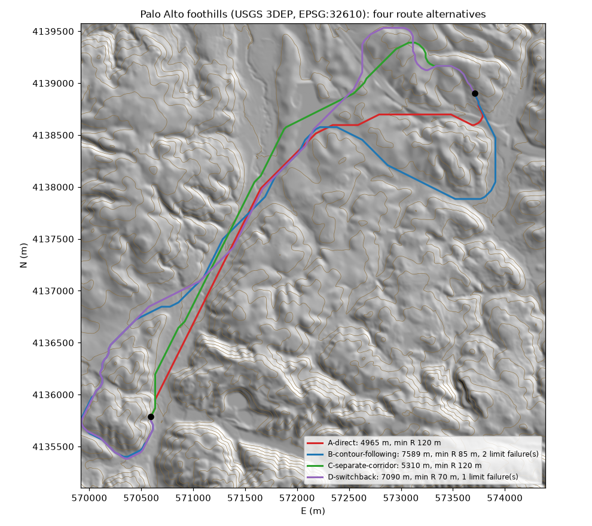

<sub>Four alternatives over 4.4 km on USGS 3DEP terrain, drawn by `scripts/terrain_figure.py` from the `route-alternatives.json` that the batch run wrote.</sub>

Results of `scripts/terrain_batch.py` on 11 runs over 9 public surfaces (end points at 15 % and 85 % of each extent, AASHTO 50 km/h, 10 % maximum grade):

| Site | Terrain | Data | Result |
|---|---|---|---|
| Palo Alto (UTM) | hills | USGS 3DEP GeoTIFF | recommended A-direct; B and D exceed the screening limits |
| Palo Alto (state plane, US ft) | hills | USGS 3DEP GeoTIFF, EPSG:2227 | recommended C-separate-corridor; all four within limits |
| Kansas | flat | USGS 3DEP | recommended B-contour-following |
| Iowa | rolling | USGS 3DEP | recommended B-contour-following |
| Autzen, Oregon | flat urban | LAZ point cloud, intl ft + US survey ft vertical | recommended A-direct (D duplicates A, flagged) |
| Blue Mountains, NSW | plateau / escarpment | Copernicus GLO-30 (geographic → UTM) | recommended **D-switchback**, the only alternative within the limits |
| Boulder, CO (20 m and 10 m cells) | mountain | USGS 3DEP | **INFEASIBLE**: about 640 m climb over 4.3 km needs ≥ 6.4 km of road at 10 %, and no grade-limited path exists in the box |
| West Virginia (20 m and 10 m cells) | dissected Appalachian | USGS 3DEP | **INFEASIBLE**: A–C exceed the fill / wall limits; D finds no grade-limited path at 20 m and exceeds the limits at 10 m |
| Lake District, UK | mountain | Copernicus GLO-30 | **INFEASIBLE**: 223 m climb over 3.9 km needs ≥ 2.2 km at 10 % and the grade-limited search finds no path |

Per-alternative lengths, grades, radii, earthwork, limit failures and runoff results are in **[docs/terrain-tests.md](docs/terrain-tests.md)**.

## Superelevation runoff sized during alignment design

Transition lengths are set while the alignment is fitted, so the runoff check passes by design.

1. For each candidate radius, the tool computes e (AASHTO Method 1, or the profile's own e/R rule) and the required development length L = w·(e + nc) / Δmax. Δmax is the maximum relative gradient of the profile in force (AASHTO table, or the DMRB / Austroads value entered for that profile).
2. The spiral is the preferred length, shortened to what the deflection allows, and never shorter than L (rounded up to 5 m).
3. The curve's tangent length, spirals included, has to fit in the available tangent. If it does not, the radius is reduced towards the minimum. On small deflections, where the spirals cannot fit inside the turn, a flatter radius is tried instead (up to 4 × the preferred radius), which also lowers e and L.
4. A corner that still cannot fit is removed and the curves are re-fitted. If it is the last one, the curve is kept and a `transition_notes` entry records it as a design exception with the reason.

| | Superelevation failures before | After |
|---|---:|---:|
| Demo (selected route A) | 0 | 0 (geometry unchanged) |
| Real-terrain alternatives, 6 sites × 4 | 1–36 per alternative | **0** on all 24 |

An independent Python re-check recomputes e, L, spiral ≥ L, spirals within the deflection, and curve overlap for the selected demo route (14 checks), and recomputes L for every fitted curve in the terrain batch (0 short spirals).

## Civil 3D handoff: LandXML cross sections and 3D CAD model

- `export_landxml` writes LandXML 1.2 in the session units (Metric, or Imperial in international or US survey feet; `units` overrides): `Project`, `Application`, `CoordinateSystem` (EPSG when known; the demo passes 32610), the EG TIN, the corridor FG TIN with breaklines (CL, edges of pavement, daylight lines) and the daylight outer boundary, parcels with holes as nested parcels, the alignment (Line / Curve / clothoid Spiral with `staStart`, radius, delta, chord, tangent, spiral constants), the design profile (PVI / ParaCurve) and a sampled EG `ProfSurf`, `Superelevation` stations per curve, `CrossSects` with `DesignCrossSectSurf`, and pipe networks (inverts, diameters in mm or inches, material). Before this release the file was always metric, had no breaklines, boundary, superelevation, EG profile, project metadata or parcel holes, and lines and curves had no stations. Element mapping, the documented Civil 3D and ORD import behaviour, and the checks are in [docs/landxml.md](docs/landxml.md). **Not yet tested in Civil 3D or OpenRoads Designer.**
- CI validates every exported LandXML file against the LandXML 1.2 XSD and re-reads `design.xml` with an independent parser ([`landxml_roundtrip.py`](scripts/landxml_roundtrip.py)) in both demo runs: 25 / 25 checks each. Alignment positions at the 76 corridor stations agree with `corridor.json` to 1.07e-6 m (SI) and 6.6e-7 m (US, feet converted back), profile elevations to 4.07e-7 m and 1.34e-7 m, FG TIN at the centreline to 4.91e-5 m and 1.57e-7 m, and the 25 pipe inverts to 4.91e-5 m and 1.51e-5 m.
- `export_cad_model` writes `civil3d-model.dxf`, a 3D model in world coordinates and metres. In the demo it holds 12,691 3D faces (11,089 EG TIN faces on `V-TOPO-SURF`, 1,602 FG faces on `C-ROAD-SURF`), the 3D centreline, 18 corridor feature lines, the wall tops, 25 pipes at invert and 27 structures at rim. Layers follow the drafting profile (NCS names in the US) or an agency `layer_map`. CI re-reads the file with ezdxf: the face count matches the LandXML TIN, and the centreline z matches the profile.
- DWG is optional. With ODA File Converter installed, `export_cad_model` with `dwg_version` (`ACAD2013` = AC1027, `ACAD2018` = AC1032) and `dwg_include_sheets` converts the model and every sheet into `dwg/`. ODA File Converter is a separate free download under its own terms and is not bundled. LibreDWG 0.13.3 `dxf2dwg`, tried earlier on this model, produced a DWG that read back empty.
- Substitute testing on Linux ([docs/interop-tests.md](docs/interop-tests.md)): ODA File Converter 27.9 round trip of all 53 DXF files through DWG 2013 and 2018, 0 mismatches in entity counts, layers and extents. ODA and ezdxf stand in for Civil 3D and 12d here. BricsCAD V27 (Linux trial, another substitute) is installed but stops at its trial-activation login, so no file has been opened in it yet. None of these files has been opened in Civil 3D, AutoCAD, 12d or BricsCAD.

## Design package v1

`export_design_package` writes `design-package/`: `manifest.json` (schema version 1.0.0, units, CRS, source run with the audit-log head, SHA-256 of every file) and canonical-SI JSON for alignments, profiles, superelevation, assemblies (ordered subassembly-like parameter sets), corridor regions (station range, assembly, frequency, targets), surfaces (references into the package LandXML), pipe networks, parcels and the ROW line, quantities (earthwork, mass haul, BoQ) and the sheet list, plus `design.xml`. `validate_design_package` checks a folder against the committed JSON Schemas in [`schema/design-package/v1/`](schema/design-package/v1) and against the manifest hashes.

```
design-package/
  manifest.json  alignments.json  profiles.json  superelevation.json  assemblies.json  corridors.json
  surfaces.json  pipes.json  parcels.json  quantities.json  sheets.json  design.xml
```

CI generates the package for the SI and US demos and runs [`package_check.py`](scripts/package_check.py) (full `jsonschema` validation, hashes, XSD, cross-checks against the run's own files): 20 / 20 checks in each run. [docs/design-package.md](docs/design-package.md) also gives the intended Civil 3D .NET mapping (`Alignment.Create`, `Profile.CreateByLayout`, assemblies and subassemblies, `CorridorCollection.Add`) as a specification only. No Civil 3D or ORD add-in reads the package yet.

## Construction-scale sheet set

`generate_construction_set` writes `construction-set.pdf`, `cs-NN.dxf/svg` and `construction-register.csv`, alongside the main 38-sheet set. The demo set has 14 sheets:

| Sheet | Content | Scale |
|---|---|---|
| CS-G-701 | survey control (engineer or surveyor input) and horizontal / vertical alignment data: Δ, R, Ls, TS/SC/CS/ST stations, VPIs | NTS |
| CS-C-101 … 104 | plan and profile split at match lines on round stations (0+300, 0+600, 0+900); each match line names the adjoining sheet; contours, property lines and right-of-way on the plan | 1:500 (1" = 50' in US units) |
| CS-C-301 … 308 | cross sections at the standard interval (20 m, 50 ft in US units) with EG, FG, datum, R/W lines and construction limits | 1:200 |
| CS-C-601 | summary of quantities by pay item, earthwork split per plan sheet | NTS |

| Alignment data | Plan and profile | Cross sections | Quantities |
|---|---|---|---|
| [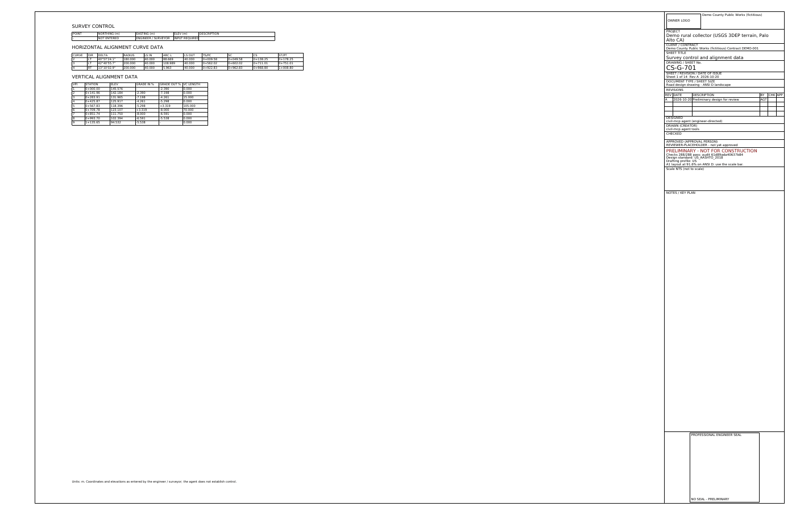](docs/img/cs/cs-01.png) | [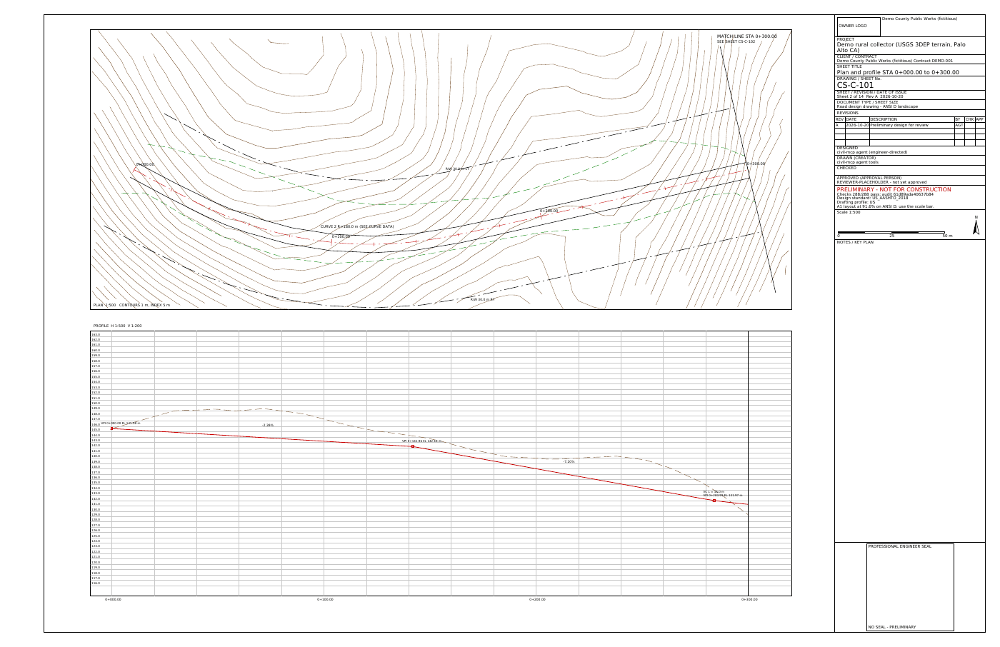](docs/img/cs/cs-02.png) | [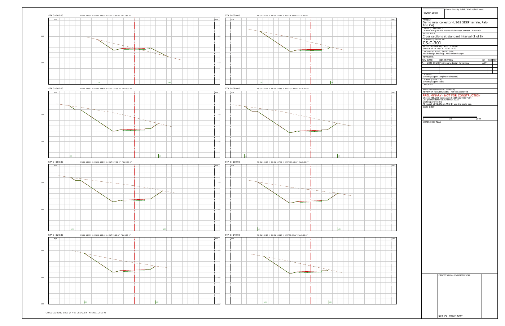](docs/img/cs/cs-06.png) | [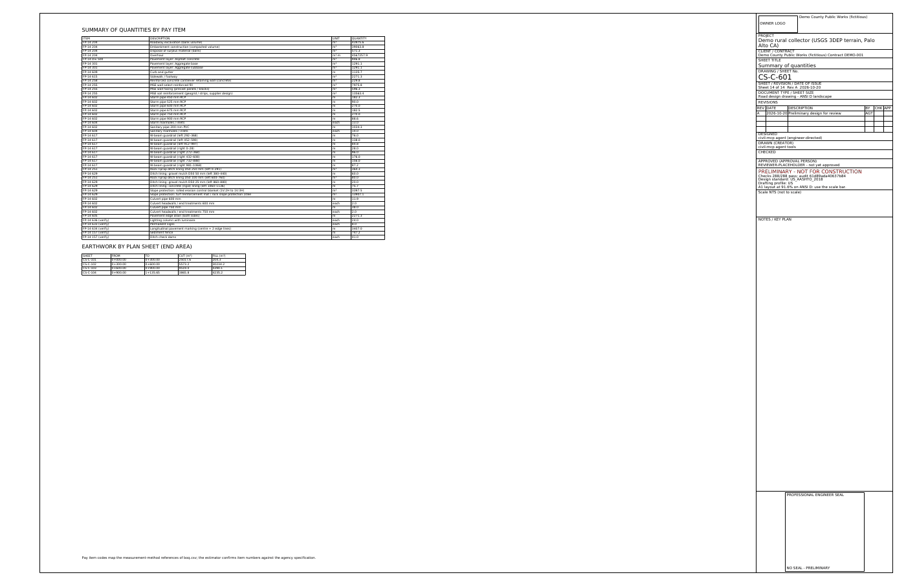](docs/img/cs/cs-14.png) |

Set checks: standard scale (pass), continuous match lines (pass), full coverage of the alignment (pass), and engineer inputs present. That last check **fails in the demo**, because no property lines or survey control points were entered, and the sheet says so.

## Blender visualisation (concept / preliminary)

`export_blender_scene` writes `scene.glb` (glTF 2.0: terrain, a copy of the terrain trimmed exactly to the daylight lines so ground meets the slope catch points without showing through, pavement, the pavement structure as one closed solid per assembly layer following crossfall and superelevation, earthwork slopes, walls, pipes, structures and the route alternatives as coloured ribbons), `scene.json` (georeference origin E0/N0/Z0 + EPSG, a 229-point camera path along the centreline, metrics per alternative) and `blender_scene.py`, the render script.

```bash
blender -b -P blender_scene.py -- /path/to/project --frames 96 --res 1280x720 --samples 16
```

**Walkthrough video** (39.5 s, 720p, rendered from the demo run with [`scripts/render_walkthrough_animation.py`](scripts/render_walkthrough_animation.py)): terrain, route alternatives, alignment, profile, earthwork, a pavement cutaway with the three layers, drainage, and a drive-through from 0+000 to 1+135.65.

[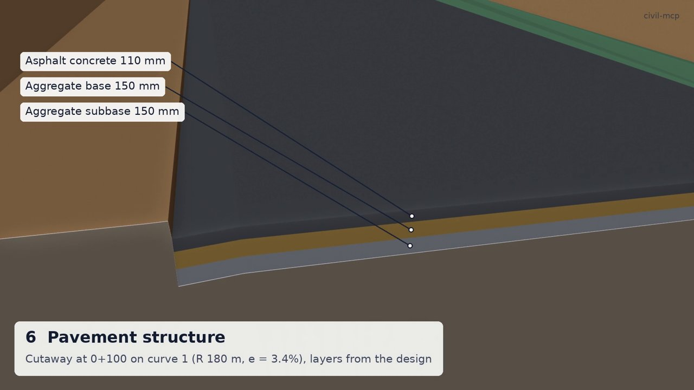](docs/media/civil-mcp-walkthrough-720p.mp4)

Stills from that headless run on the demo (Blender 4.2.3, Cycles on CPU):

| Overview with all four alternatives | Selected route A-direct |
|---|---|
| 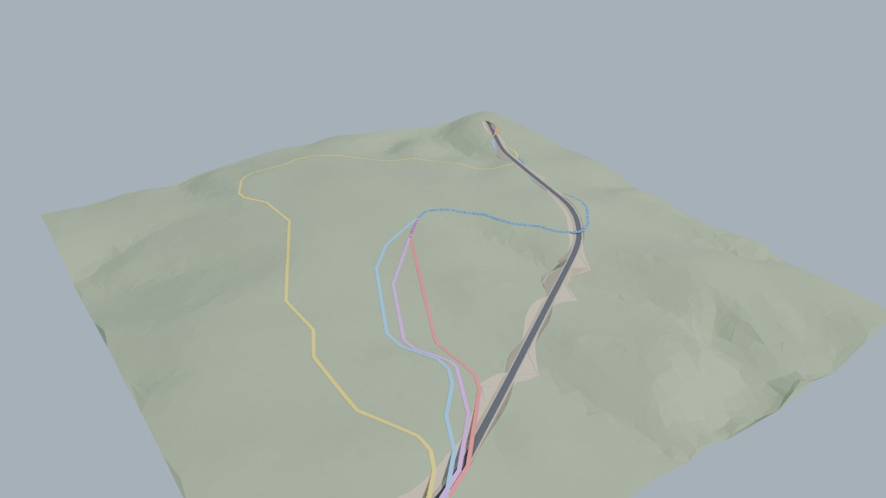 | 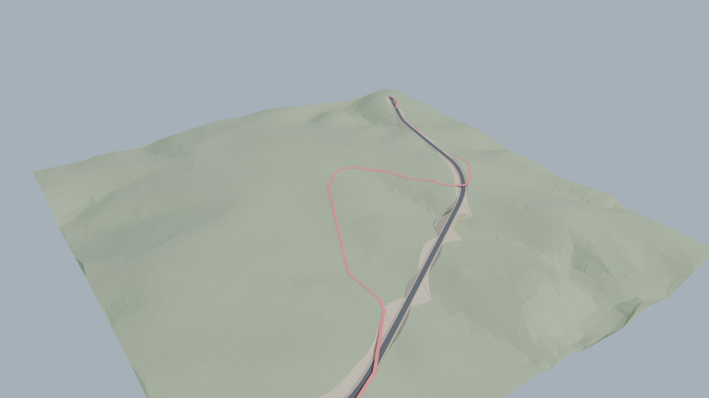 |
| **Switchback alternative D** | **Driver's eye view** |
| 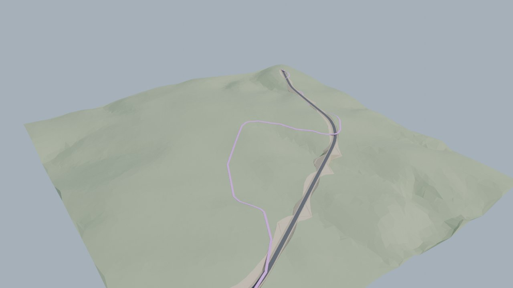 | 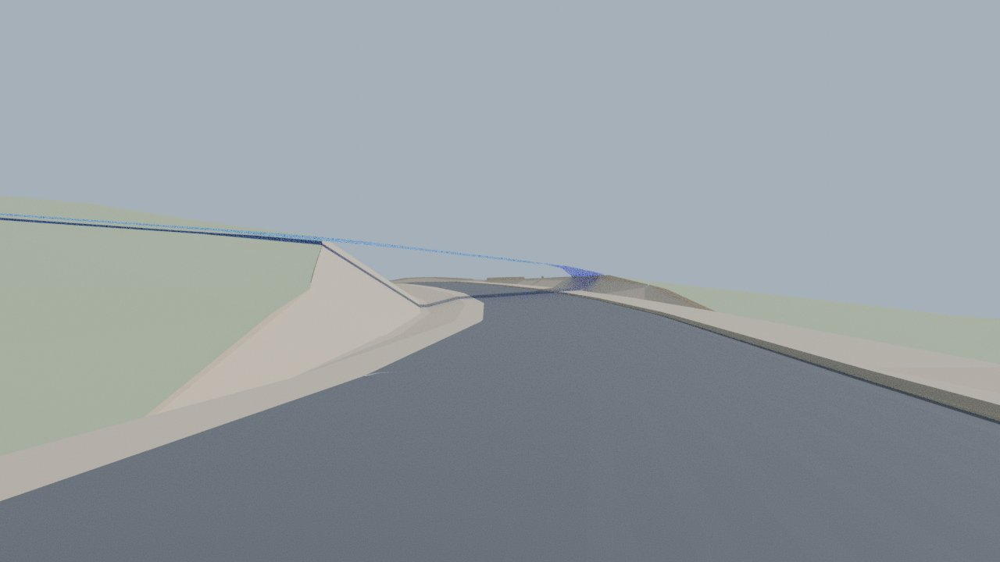 |

The script also writes the remaining stills, `flythrough.mp4`, `scene.usdc` and `scene.blend`. For interactive work, pair it with an open-source Blender MCP server such as [blender-mcp](https://github.com/ahujasid/blender-mcp) (`uvx mcp-for-blender`): open `scene.blend` and let the agent adjust materials, cameras or annotations. Edits in Blender do not change the design. See [docs/blender.md](docs/blender.md).

## Units: SI or US customary

civil-mcp works in SI (metres) by default. You can switch between SI and US customary at any time with the `set_units` tool, and switch back the same way:

```json
{"name":"set_units","arguments":{"system":"US"}}
{"name":"set_units","arguments":{"system":"US","foot":"survey"}}
{"name":"set_units","arguments":{"system":"SI"}}
```

With `system` set to `US`:
- Tool results use US units, and keys are renamed to match (`radius_m` becomes `radius_ft`, `cut_m3` becomes `cut_cy`, `design_speed_kmh` becomes `design_speed_mph`).
- Inputs can use US keys (`radius_ft`, `design_speed_mph`) or SI keys. Lengths without a suffix are read in feet.
- Drawings use 100 ft stations (12+34.56), engineering scales (1" = 50', 1" = 5' vertical), labels in ft and in, and a scale bar in feet.
- Reports and CSV files are in US units, and the bill of quantities uses CY, SY, LF, TON and EA.
- `export_landxml` writes `Imperial` LandXML (feet or US survey feet, pipe diameters in inches, flows in ft³/s); the design package JSON stays in SI and records the display units in its manifest.

`foot` is `international` (0.3048 m, the default) or `survey` (1200/3937 m, for older state plane data). `inputs` and `outputs` can be set separately from `system` for the JSON results only. Design calculations and checks always run in SI, and the audit log stays in SI. The demo runs in US units with `cargo run --release -p civil-demo -- demo-out-us --units us`.

## Drawing set (all 38 sheets)

Click a thumbnail to open the full-size sheet (2000 px PNG). The vector PDF is [docs/sheets.pdf](docs/sheets.pdf).

| | | | |
|:---:|:---:|:---:|:---:|
| [](docs/img/sheets/sheet-01.png)<br/><sub>01 Cover, index, notes</sub> | [](docs/img/sheets/sheet-02.png)<br/><sub>02 Route alternatives</sub> | [](docs/img/sheets/sheet-03.png)<br/><sub>03 Plan and profile</sub> | [](docs/img/sheets/sheet-04.png)<br/><sub>04 Typical sections</sub> |
| [](docs/img/sheets/sheet-05.png)<br/><sub>05 Superelevation</sub> | [](docs/img/sheets/sheet-06.png)<br/><sub>06 Pavement and subgrade</sub> | [](docs/img/sheets/sheet-07.png)<br/><sub>07 Cross sections 1</sub> | [](docs/img/sheets/sheet-08.png)<br/><sub>08 Cross sections 2</sub> |
| [](docs/img/sheets/sheet-09.png)<br/><sub>09 Cross sections 3</sub> | [](docs/img/sheets/sheet-10.png)<br/><sub>10 Cross sections 4</sub> | [](docs/img/sheets/sheet-11.png)<br/><sub>11 Cross sections 5</sub> | [](docs/img/sheets/sheet-12.png)<br/><sub>12 Cross sections 6</sub> |
| [](docs/img/sheets/sheet-13.png)<br/><sub>13 Cross sections 7</sub> | [](docs/img/sheets/sheet-14.png)<br/><sub>14 Roadside protection</sub> | [](docs/img/sheets/sheet-15.png)<br/><sub>15 Storm profile</sub> | [](docs/img/sheets/sheet-16.png)<br/><sub>16 Sanitary profile</sub> |
| [](docs/img/sheets/sheet-17.png)<br/><sub>17 Drainage details</sub> | [](docs/img/sheets/sheet-18.png)<br/><sub>18 Mass haul and quantities</sub> | [](docs/img/sheets/sheet-19.png)<br/><sub>19 Locality plan (OSM)</sub> | [](docs/img/sheets/sheet-20.png)<br/><sub>20 Intersection + sight</sub> |
| [](docs/img/sheets/sheet-21.png)<br/><sub>21 Drainage areas</sub> | [](docs/img/sheets/sheet-22.png)<br/><sub>22 Culverts</sub> | [](docs/img/sheets/sheet-23.png)<br/><sub>23 Slope stability</sub> | [](docs/img/sheets/sheet-24.png)<br/><sub>24 Subsurface drainage</sub> |
| [](docs/img/sheets/sheet-25.png)<br/><sub>25 Wall type selection</sub> | [](docs/img/sheets/sheet-26.png)<br/><sub>26 Wall reinforcement</sub> | [](docs/img/sheets/sheet-27.png)<br/><sub>27 Signing and marking</sub> | [](docs/img/sheets/sheet-28.png)<br/><sub>28 Lighting</sub> |
| [](docs/img/sheets/sheet-29.png)<br/><sub>29 Utilities</sub> | [](docs/img/sheets/sheet-30.png)<br/><sub>30 Right-of-way</sub> | [](docs/img/sheets/sheet-31.png)<br/><sub>31 Erosion and sediment</sub> | [](docs/img/sheets/sheet-32.png)<br/><sub>32 Landscape</sub> |
| [](docs/img/sheets/sheet-33.png)<br/><sub>33 Traffic management</sub> | [](docs/img/sheets/sheet-34.png)<br/><sub>34 Signals</sub> | [](docs/img/sheets/sheet-35.png)<br/><sub>35 Capacity / LOS</sub> | [](docs/img/sheets/sheet-36.png)<br/><sub>36 Rigid pavement</sub> |
| [](docs/img/sheets/sheet-37.png)<br/><sub>37 Constructability</sub> | [](docs/img/sheets/sheet-38.png)<br/><sub>38 Standard details atlas</sub> | | |

---

## Sheet frames and drafting standards

Every sheet in `generate_drawings` and `generate_construction_set` (PDF, per-sheet SVG and DXF) is composed into a configurable frame and title block. Five drafting profiles are built in: US, CA, UK, AU and NZ. Selecting a profile sets the default sheet size, borders, title-block fields, layer names, line weights and types, sheet numbering and revision codes. Any field can then be overridden.

| Tool | What it does |
|---|---|
| `list_sheet_frames` | Sheet sizes (ISO A0-A4, ANSI A-E, ARCH A-E1), the five profiles and their default frame, and the current frame |
| `get_drafting_standard` | One profile in full. Each parameter is marked `verified`, `formula` or `engineer` and carries its source |
| `set_sheet_frame` | Profile, size, orientation, margins, title-block fields, revision table, custom DXF/SVG/JSON template, layer map, sheet ID pattern. Logged in the audit chain. It does not void an approval |
| `preview_sheet_frame` | Renders an empty frame to `frame-preview.pdf/.svg/.dxf` and returns the layout and checks |
| `check_drawing_standards` | Runs checks FR-01 to FR-14 on the last drawing set |

```json
{"name":"set_sheet_frame","arguments":{"frame":{"profile":"UK","size":"ISO A1","orientation":"landscape",
 "fields":{"project":"A40 junction","client":"County Council","project_code":"A40J","originator":"ABC",
 "revisions":[{"rev":"P01","date":"2026-10-20","description":"Preliminary issue","by":"AGT"}]}}}}
```

| Profile | Default sheet | Title block | Layer names | Sheet IDs | First revision | Parameters (verified / formula / engineer) |
|---|---|---|---|---|---|---|
| US | ANSI D | right strip, PE seal box | NCS (`C-ROAD-CNTR`) | UDS (`G-001`, `C-101`) | A | 4 / 4 / 9 |
| CA | ISO A1 | ISO 7200, 180 mm | NCS-style | UDS-style | A | 11 / 5 / 5 |
| UK | ISO A1 | ISO 7200, 180 mm | BS 1192 style (`C-00-M_Alignment`) | ISO 19650 UK NA (`PRJ-ORG-ZZ-ZZ-DR-C-0001`) | P01 (status S3) | 13 / 7 / 3 |
| AU | ISO A1 | ISO 7200, 180 mm | ISO-style | `PRJ-C-0001` | A | 11 / 5 / 5 |
| NZ | ISO A1 | ISO 7200, 180 mm | ISO-style | `PRJ-C-0001` | A | 11 / 5 / 4 |

All ISO profiles have ISO 5457 centring marks and grid references. Agency CAD manuals (state DOT, National Highways, TfNSW, NZTA) are not shipped. Their specific values are engineer inputs with a default.

Sheet 3 (plan and profile) in each profile, rendered from the generated PDFs by `scripts/render_readme_images.py --frames`:

| US, ANSI D | CA, ISO A1 |
|---|---|
|  |  |
| **UK, ISO A1** | **AU, ISO A1** |
|  |  |
| **NZ, ISO A1** | **UK, ISO A3** |
|  |  |

Title-block close-ups:

| US | UK | AU, A4 portrait |
|---|---|---|
|  |  |  |

Drawing-standard checks (kept separate from the 288 design checks and the approval gate):

| Check | What it covers | Severity |
|---|---|---|
| FR-01 / FR-02 / FR-03 | sheet size, margins, frame line | mandatory |
| FR-04 | title-block width | advisory |
| FR-05 | required title-block fields; checker required once approved | mandatory |
| FR-06 / FR-07 | sheet ID pattern; revision code pattern, no C revisions while preliminary | mandatory |
| FR-08 / FR-08b | seal box present; no seal shown while preliminary | mandatory |
| FR-09 / FR-09b | title-block text at least 2.5 mm; small content text | mandatory / advisory |
| FR-10 / FR-11 | content inside the drawing area; layer names | mandatory |
| FR-12 / FR-12b | scale bar; preferred scales | mandatory / advisory |
| FR-13 / FR-14 | north arrow on plans; grid references (ISO) | mandatory |

Seven profile and size combinations (`cargo run --release --example frames_gallery -p civil-demo -- out`) give 0 mandatory failures and 2 advisories each. The 2 advisories are FR-09b and FR-12b: content is drawn on an A1 layout and scaled to fit the sheet, so a smaller sheet gives smaller text and non-preferred scales. The scale bar shows the plotted scale.

## Standards coverage by country

Each profile classifies every geometric design parameter as **verified** (a value from the published source, cited), **formula** (computed from a published formula), or **engineer input** (from a copyrighted or paywalled table, or not verified; it must be entered and is flagged in the register). The counts below are measured with `cargo run -p civil-core --example profile_register` on a minimal basis.

| Profile | Verified | Formula | Engineer input | Inputs the profile will not default |
|---|---:|---:|---:|---|
| 🇺🇸 US — AASHTO Green Book 2018 | 4 | 2 | 4 | e_max, f_max, max grade, max relative gradient |
| 🇨🇦 Canada — TAC GDG 2017 | 0 | 2 | 9 | + reaction time, deceleration, eye/object height, sag K |
| 🇬🇧 UK — DMRB (CD 109 …) | **10** | 0 | 2 | max relative gradient |
| 🇦🇺 Australia — Austroads GRD | 0 | 2 | 9 | + reaction time, deceleration coefficient, sag K |
| 🇳🇿 New Zealand — Austroads + NZTA | 0 | 2 | 9 | + reaction time, deceleration coefficient, sag K |

The method the tools use in each discipline depends on the profile:

| Discipline | US | CA | UK | AU / NZ |
|---|---|---|---|---|
| Flexible pavement | AASHTO 93 (+ layered elastic) | AASHTO 93 (TAC accepts) | CD 226 | Austroads granular chart; AGPT02 layered elastic |
| Rigid pavement | AASHTO 93 | AASHTO 93 | CD 226 | AGPT02 Ch. 9 |
| Hydrology | Rational | Rational | FEH peak (engineer input) | ARR 2019 rational |
| Roadside | RDG 2011 | TAC Ch. 7 | CD 377 / RRRAP inputs | AGRD Part 6 |
| Signal warrants | MUTCD Warrant 1 | TAC priority points | local thresholds (engineer) | local thresholds (engineer) |
| Signs / markings | MUTCD 11th | MUTCDC | TSRGD 2016 / TSM | AS 1742 / NZ TCD |
| Retaining walls | GEC 11 / GEC 7 / LRFD | CSA S6 refs | BS 8006 refs | AS 4678 refs |
| BoQ coding | FHWA FP-14 | provincial (engineer) | SHW series (MCHW Vol 1) | TfNSW QA (example) / NZTA |

The CI tests cover the non-US paths: `tests/profiles_v5.rs` and `tests/profiles_v6.rs` (UK FEH gate, CD 225 foundation classes, TAC signal points, AU ARR / AGPT02).

## Validation summary

Full record: **[docs/VALIDATION.md](docs/VALIDATION.md)**. Every row runs in [CI](.github/workflows/ci.yml), on both the SI and the US-units demo, unless noted.

| Check | What is compared | Result |
|---|---|---|
| Independent re-checks, base ([`independent_check.py`](scripts/independent_check.py)) | areas, volumes, mass haul, superelevation and runoff, clothoids, Manning/HGL, walls, route costs, pavement, HEC-15, BoQ, LandXML XSD and cross sections, DXF audit, 3D CAD model, glTF scene (incl. pavement layer thicknesses, trimmed ground on the survey surface), ROW take areas, costs and ranking, LandXML parcels, design package hashes | **155 / 155** OK |
| LandXML round trip ([`landxml_roundtrip.py`](scripts/landxml_roundtrip.py)), SI and US files | own Line / Curve / Spiral and PVI evaluators vs corridor stations, TIN samples, FG breaklines and boundary, superelevation stations, pipe inverts, diameters and lengths | **25 / 25** OK per run |
| Design package ([`package_check.py`](scripts/package_check.py)) | `jsonschema` validation of manifest and 10 JSON files, SHA-256, package LandXML XSD, alignment chain and tangency, content vs run files | **20 / 20** OK per run |
| Independent re-checks, v5 ([`independent_check_v5.py`](scripts/independent_check_v5.py)) | hydrology, culverts (HDS-5), slope stability, subsurface drainage, walls, land, locality | **70 / 70** OK |
| Independent re-checks, v6 ([`independent_check_v6.py`](scripts/independent_check_v6.py)) | layered elastic vs PyMastic and KENPAVE, MSE, wall shear/crack/footing, signals, capacity, rigid, landscape, locality | **81 / 81** OK |
| Layered elastic vs published KENPAVE 3-layer example | deflection, σz, εr, εz | ≤ **0.088 %** |
| Civil 3D LandXML fixtures (2022/2023/2025) | surfaces, a 23.47 km alignment, 411 pipes | ≤ 2e-12 rel. / 2.6e-10 m / 1.3e-9 m |
| DWG round trip through ODA File Converter 27.9 (local run; CI skips it) | 53 DXF → DWG AC1027 and AC1032 → DXF, entity counts, layers, extents ([`dwg_compare.py`](scripts/dwg_compare.py)) | **0** mismatches over 164,122 entities ([details](docs/interop-tests.md)) |
| BricsCAD V27 Linux trial (substitute; local) | open DWG / DXF, AUDIT, LANDXMLIMPORT | **not run yet**: installed, blocked at trial activation ([details](docs/interop-tests.md)) |
| Real-terrain batch (local run; CI skips it) | 11 runs, 9 surfaces; runoff re-check on every fitted curve | see [docs/terrain-tests.md](docs/terrain-tests.md) |
| Rust tests (`cargo test`) | unit tests with worked examples, LandXML round trip (metric, international ft, US survey ft), design package validator, MCP stdio, profiles, frames, terrain import, full pipeline | all pass; `cargo fmt --check` and `clippy -D warnings` clean |

The re-check scripts share no code with the Rust tools. They re-derive each value from the files the tools wrote, using NumPy, SciPy, ezdxf and PyMastic.

## Deliverables matrix

[docs/DELIVERABLES.md](docs/DELIVERABLES.md) maps the 55 deliverables a road design package normally contains, from basis of design to construction staging, to what civil-mcp produces.

| Implemented | Partial | Interface (hand-off to a specialist) | Gap |
|---:|---:|---:|---:|
| **52** | 1 (structures: bridges) | 2 | **0** |

## Status and limits

- **Depth is concept / 30 %.** The sheets follow a 60 %-style format (title blocks, match lines, gridded sections, quantities), but the content is concept level: no detailed drainage profiles per structure, no signing details, no specifications.
- **This is not engineering approval.** The demo "engineer" is a placeholder. Nothing here has been reviewed by a licensed engineer, and every sheet stays PRELIMINARY until a real engineer approves it.
- **DWG needs ODA, and nothing has been opened in Civil 3D.** DWG comes only through an installed ODA File Converter; its round trip was checked with ezdxf, a substitute. Neither the LandXML, the DXF nor the DWG has been opened in Civil 3D, AutoCAD, 12d or BricsCAD, and corridor volumes and hydraulics have not been compared with Civil 3D runs (no public files were found).
- **LandXML and the design package are untested in Civil 3D and ORD.** Both are checked against their schemas and by independent parsers only. Civil 3D's documented import list does not include `CrossSects`; there are no station equations, `AlignPIs`, `Cant` or Manning's n; structure sizes are placeholders. The package has one alignment, one profile and one corridor region, no intersections, gradings or wall objects, and its Civil 3D API mapping is a written specification with no add-in behind it.
- **MCP clients are not tested end to end.** Client configs follow each client's docs; only the raw stdio protocol is tested. See [Works with](#works-with-mcp-clients).
- **Copyrighted tables are not shipped.** Values such as Green Book side friction, TAC, Austroads, CD 226 figures and AGPT02 equivalent-stress tables are engineer inputs. Transcribed values must be checked against the edition in use.
- **Geotechnical inputs are placeholders.** Slope, wall and foundation soil parameters stand in for a ground-investigation report. MSE internal stability, global stability and detailing belong to the supplier and the geotechnical engineer.
- **One full demo site.** The complete design, drawings and independent re-checks come from one terrain sample (Palo Alto). The 11 real-terrain runs stop at route alternatives.
- **ROW cost is a screening estimate from your data.** civil-mcp has no valuation model and does not appraise. Every land value, rate, improvement value, fallback rate and admin or severance factor is user input, and missing values make the cost unknown. Takes come from the corridor daylight lines plus a buffer; they do not come from a legal ROW plan or a boundary survey. Partial-take remnants are judged by area only (no shape, access or zoning rules). Parcel geometry must be in the terrain's projected CRS (m, ft or US survey ft). Polygon holes count in areas and go to LandXML as nested parcels (LandXML 1.2 has no hole element), and parcel lines in the CAD model and Blender scene are draped at their vertices only. The demo parcels are synthetic.
- **Route search is approximate.** It runs on a grid (10 m or the import cell) and its cost proxy is relative. Earthwork limits are screening defaults.
- **Runoff gaps.** The tangent runout before the first curve and after the last one is not checked against the alignment ends (demo: first curve starts 9.6 m from the start, runout 10.8 m; reported as a note). Hairpins with no room for spirals become simple curves whose runoff is covered by the overlap check only. The Python runoff re-check covers the AASHTO profile only.
- **Bridges are out of scope.** They are handed to a structures specialist (`specialist_handoffs`).
- **Signals and capacity are concept-level only.** HCS, Synchro, SIDRA or LINSIG govern detailed design. UK/AU/NZ warrants need local thresholds.
- **Approver identity is declared only.** MCP cannot authenticate the human approver; deployments need authentication in front of approval.
- **Sheet frames are SI only.** R12 DXF carries no lineweights (they are in PDF and SVG). Templates read lines, rectangles and text; SVG group transforms are ignored. Content is scaled from an A1 layout, so small sheets give text below 2.5 mm (advisory). The default issue date is UTC.
- **Blender output is presentation only.** Materials and lighting are simple and the renders are not a design deliverable.

## Roadmap

- [ ] **Remote transport:** Streamable HTTP MCP with authentication, so web-only clients can connect and approval can be tied to a real identity.
- [ ] **End-to-end client testing:** Claude Code, Claude Desktop, Cursor, Codex, Gemini CLI and VS Code, with recorded sessions.
- [ ] A Civil 3D add-in that builds native objects from the design package (spec in [docs/design-package.md](docs/design-package.md)).
- [ ] Open the LandXML and 3D DXF in Civil 3D and compare corridor volumes and pipe hydraulics, given a public or partner dataset.
- [ ] Tangent-runout checks at the alignment ends, and runoff re-checks for the DMRB and Austroads profiles.
- [ ] 3D wall and structure solids for clash checks, using a permissive B-rep kernel such as [truck](https://github.com/ricosjp/truck).
- [ ] Full demo projects beyond Palo Alto, including non-US sites.

## Geometry kernel

Design at this stage is TIN math plus 2D/3D alignment math, so there is no B-rep kernel. Triangulation uses [`delaunator`](https://crates.io/crates/delaunator) (ISC); everything else is in this repo. No GPL/LGPL code (OpenCASCADE, FreeCAD, SolveSpace) was read or used.

## License and attribution

- Code: **Apache-2.0** ([LICENSE](LICENSE)).
- Font: DejaVu Sans (`crates/civil-core/assets/DejaVuSans-LICENSE.txt`).
- Terrain: USGS 3DEP (public domain).
- Basemap: © OpenStreetMap contributors, ODbL 1.0. See [data/basemap/ATTRIBUTION.md](data/basemap/ATTRIBUTION.md).
- Test fixture `c3dprofile2.xml`: MIT (RustedGeom/rusted-geom).
- Independent check: [PyMastic](https://github.com/Mostafa-Nakhaei/PyMastic), cloned in CI and not redistributed.
