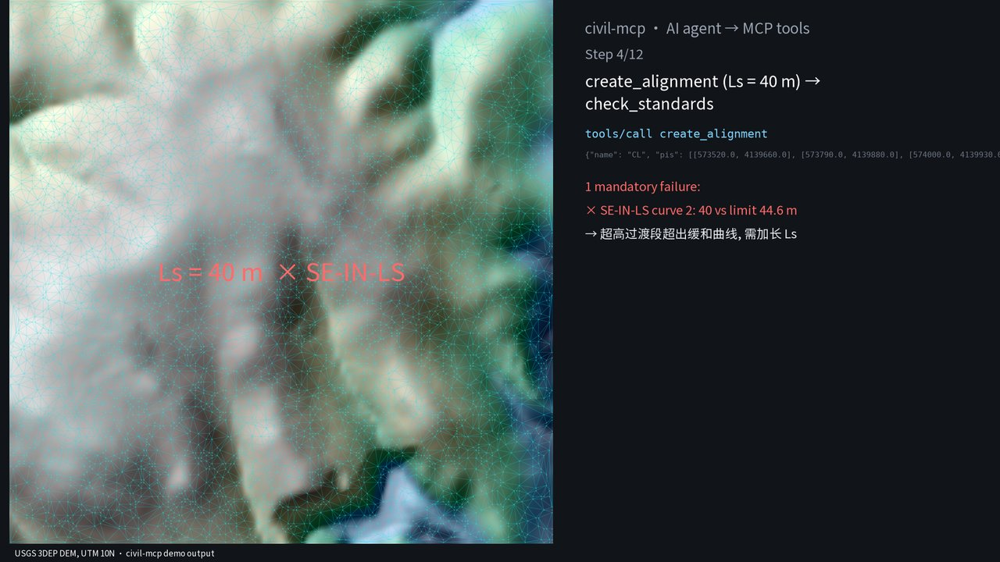
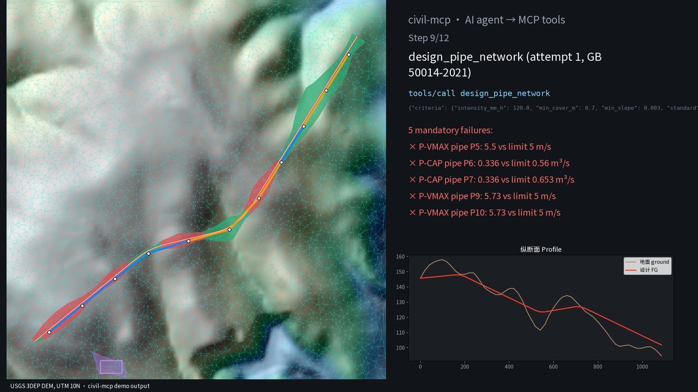
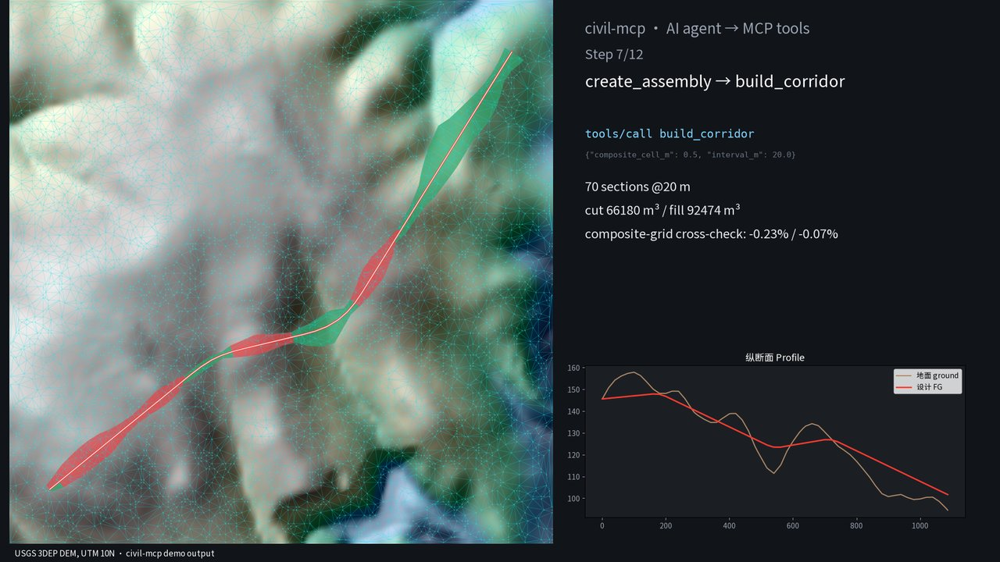
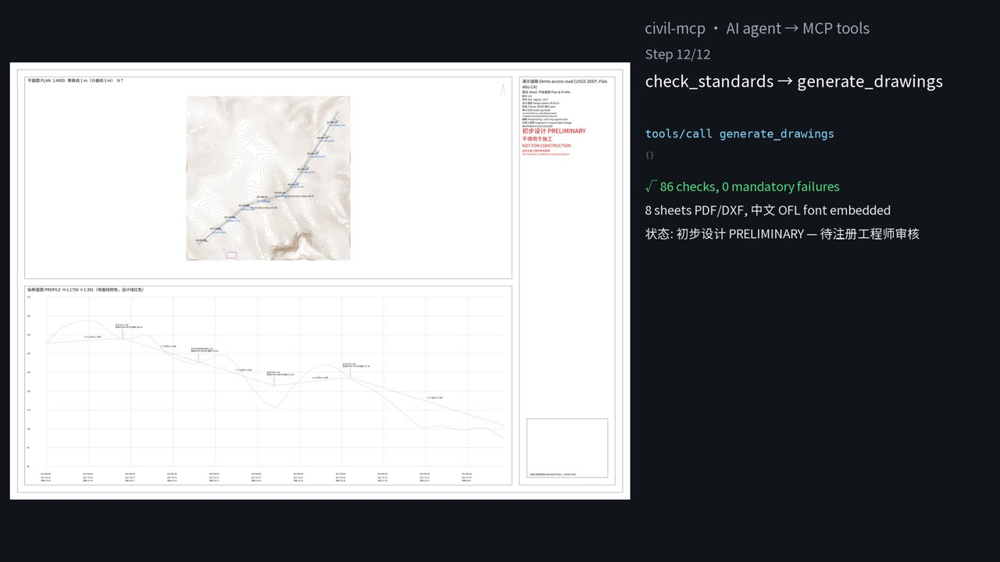

# civil-mcp

Agent-native road and site design tools in the spirit of Civil 3D, exposed as MCP tools: survey points → TIN → alignment with clothoid spirals → superelevation → profile → assembly/corridor with ditches and benched slopes → pad grading → gravity storm/sewer network → mass haul and material tables → plan/profile, cross-section and quantity sheets (PDF + DXF, Chinese text) → LandXML 1.2 export → review report. Every call goes into a hash-chained audit log with the rule it applied. Nothing is marked anything other than **初步设计 PRELIMINARY – NOT FOR CONSTRUCTION** until an engineer records an approval, and any later design change voids that approval.

**This is not a substitute for a licensed engineer.** It is a tool that an engineer in responsible charge directs and checks. See [Why the engineer comes first](#why-the-engineer-comes-first).


*Every frame above is drawn from files the tools wrote during `cargo run -p civil-demo` (`run-log.jsonl`, `design.xml`, `corridor.json`, `network.json`, …) by [`scripts/animate.py`](scripts/animate.py). Red/green = cut/fill footprint. The failed attempts are real: the first spiral length and the first pipe sizing fail mandatory checks, and the agent revises both.*

## Try it (offline, one command)

```bash
cargo run --release -p civil-demo
```

Uses the bundled USGS 3DEP sample ([data/SOURCE.md](data/SOURCE.md)) and writes `demo-out/`. Committed copies: [sheets.pdf](docs/sheets.pdf) (8 sheets), [review.html](docs/review.html), [design.xml](docs/design.xml) (LandXML 1.2), [run-log.jsonl](docs/run-log.jsonl).

What the demo does (JTG D20-2017, 40 km/h, e_max 0.08, μ 0.04, all set by the "engineer" step):

1. 5,607 points → TIN with 11,089 triangles.
2. Alignment with two curves (R 150 m, R 120 m) and 40 m clothoids. `check_standards` fails `SE-IN-LS` on curve 2: the superelevation transition needs 44.6 m, but the spiral is only 40 m. The agent lengthens the spirals to 50 m and the check passes.
3. Profile from `suggest_profile`; 34 geometry checks pass.
4. Assembly: 2 × 3.5 m lanes, 0.75 m shoulders, ditch in cut, 1:1 cut and 1:1.5 fill slopes with 2 m benches every 8 m, three pavement layers. The corridor has 70 sections; cut is 66,180 m³ and fill is 92,474 m³.
5. A 50 × 30 m yard pad graded to the ground at 2:1.
6. Storm sewer (GB 50014-2021, rational method, Manning). Attempt 1 fails 5 checks (velocity > 5 m/s, capacity). Attempt 2 upsizes and caps slopes at 3 % with drop manholes, and all checks pass.
7. Mass haul (cut factor 0.9). The final ordinate is −32,912 m³, meaning the job needs imported fill, with a balance point at K0+918.75.
8. Drawings, LandXML export, review report. 86 checks, 0 mandatory failures, status PRELIMINARY.

| | |
|---|---|
|  |  |
|  |  |

## Use it from an MCP client

```bash
cargo build --release
claude mcp add civil -- /path/to/civil-mcp/target/release/civil-mcp   # e.g. Claude Code
```

stdio, JSON-RPC 2.0. Tools: `open_project`, `set_design_basis`, `load_points`, `import_landxml`, `export_landxml`, `build_surface`, `create_alignment`, `sample_ground_profile`, `suggest_profile`, `create_profile`, `design_superelevation`, `check_standards`, `create_assembly`, `build_corridor`, `get_section`, `grade`, `design_pipe_network`, `compute_quantities`, `generate_drawings`, `generate_review_report`, `record_review`, `verify_audit_log`, `get_state`. Each result carries a `provenance` record (`audit_seq`, `entry_hash`, `inputs_sha256`, `rules`).

## What is implemented

- **Alignment**: tangents, circular arcs, and symmetric clothoids (spiral–curve–spiral, Ts = (R+p)·tan(Δ/2)+k). The clothoid is integrated numerically (Gauss–Legendre). Overlapping curves are rejected and never silently adjusted.
- **Superelevation**: rotation about the centreline. AASHTO Method 1 (e = e_max·R_min/R, relative-gradient table) or JTG (i = V²/127R − μ, no-superelevation radius table, transition gradient 1/p). Checks that the transition fits inside the spiral.
- **Standards**: JTG D20-2017 (radius limit/general, max grade, min grade length, crest/sag radius, VC length, stopping sight distance table, min spiral length) and AASHTO 2018 (SSD formula, min radius, crest/sag K, spiral length range). e_max and f/μ are always engineer inputs.
- **Corridor**: assemblies (lanes, shoulder, ditch in cut, cut/fill slopes with benches, pavement layers with a subgrade datum), daylighting by ray-walk plus bisection, sections at stations and key points, average-end-area volumes cross-checked by a composite grid volume, and FG/datum surfaces.
- **Grading**: feature line or pad offset at a slope to the surface (mitred corners), with composite volume.
- **Pipes**: dendritic gravity networks; inverts from min cover, slope and drop; optional max slope with drop structures. Manning full and partial flow, and the rational method. GB 50014-2021 (min/max velocity, sewer max depth ratio table) or FHWA HEC-22 limits.
- **Quantities**: mass haul ordinates, balance points, haul moment, and a material table by station range (cut, fill, pavement layers).
- **Drawings**: PDF with an embedded, subsetted CJK font (Noto Sans SC, OFL, bundled), and DXF R12 with a `CJK` text style (`$DWGCODEPAGE ANSI_936`). Plan/profile, cross-section sheets (12 per sheet), and a mass-haul/material sheet. The title block stamp switches from PRELIMINARY only when the audit log holds an engineer approval and 0 mandatory failures.
- **LandXML 1.2**: read and write CgPoints, TIN surfaces, alignments (Line/Curve/Spiral), and profiles (PVI/ParaCurve).

The table values and formulas were transcribed by the author of this tool. **The engineer must verify them against the edition and clause they work to.**

## Validation (all numbers measured; see [docs/VALIDATION.md](docs/VALIDATION.md))

- `cargo test`: unit tests (clothoid vs series, spiral-curve-spiral closure, square pad vs exact prismoid formula (tolerance 0.5 %), Manning textbook case, ditch/bench section hand calc, …), a LandXML round-trip, a Civil 3D LandXML fixture, a stdio MCP test, and a full-pipeline test (including: the agent cannot approve, approval works only with 0 failures, a later design change voids it, and the audit chain verifies).
- [`scripts/independent_check.py`](scripts/independent_check.py) (no shared code, runs in CI) has 27 checks on the demo output. Results: section areas within 0.03 %, corridor volumes within 0.004 %, mass haul exact, haul moment −0.03 %, superelevation and transition lengths exact, clothoid chords vs SciPy Fresnel < 1e-6 m, Manning / partial-flow depth / velocity < 1e-9, pad volume vs an analytic mitred model −0.002 % (cut) / −0.27 % (fill), LandXML export valid against the 1.2 XSD, all DXFs pass `ezdxf` audit with 0 errors, and the PDF text extracts in Chinese.
- **Civil 3D LandXML files** (2022/2023 exports from public GitHub repos): the TIN 2D/3D areas we compute match the areas Civil 3D wrote into the files to ≤ 1e-12 relative on 6 surfaces. A 23.47 km Civil 3D 2023 alignment (21 elements) rebuilds with a length difference of 2.6e-10 m.

## Why the engineer comes first

US boards require the sealing engineer to be in **responsible charge** (e.g. North Carolina 21 NCAC 56.0701; Florida FBPE). NSPE's 2025 BER discussion of AI says that "reviewing drawings or documents after preparation without involvement in the design and development process does not satisfy the definition of Responsible Charge." In China, design documents take effect only once the registered engineer signs and stamps them (勘察设计注册工程师管理规定 第二十条), and they are subject to plan review against mandatory standards.

So the design is: the engineer sets the basis first, the agent works inside it, every decision is logged with its rule, the engineer reviews the checks and the trail, and only the engineer approves and seals. MCP cannot authenticate a human, and `actor: engineer:<name>` is a declaration, not proof of identity. Deployments need real authentication in front of `set_design_basis` and `record_review`.

## Geometry kernel

Civil work at this stage is TIN math and 2D/3D alignment math, so there is no B-rep kernel. Triangulation uses [`delaunator`](https://crates.io/crates/delaunator) (ISC). Everything else is in this repo. A permissive kernel ([truck](https://github.com/ricosjp/truck), [solidcore](https://github.com/tangency-labs/solidcore), or NVIDIA [usd-brep](https://github.com/NVIDIA-Omniverse/usd-brep), all Apache-2.0) becomes useful for structures, retaining walls and pipe solids. No GPL/LGPL code (OpenCASCADE, FreeCAD, SolveSpace) was read or used.

## Geometry kernel

Civil work at this stage is TIN math and 2D/3D alignment math, so there is no B-rep kernel. Triangulation uses [`delaunator`](https://crates.io/crates/delaunator) (ISC). Everything else is in this repo. A permissive kernel ([truck](https://github.com/ricosjp/truck), [solidcore](https://github.com/tangency-labs/solidcore), or NVIDIA [usd-brep](https://github.com/NVIDIA-Omniverse/usd-brep), all Apache-2.0) becomes useful for structures, retaining walls and pipe solids. No GPL/LGPL code (OpenCASCADE, FreeCAD, SolveSpace) was read or used.

## Limits

- Not compared against Civil 3D *design* outputs (corridor volumes, pipe designs). Only surface areas and alignment geometry from Civil 3D files were compared, because no public Civil 3D corridor/pipe dataset was available to me.
- Assemblies are symmetric. No curbs, widening, lane-specific superelevation, retaining walls, intersections or roundabouts. Average end area has no curvature correction.
- Grading supports mitred offsets only (no rounded corners). Pipe networks are dendritic gravity systems; there is no HGL/EGL, junction losses, pumping or pressure networks.
- No DWG. DXF R12 has been checked with `ezdxf` only, not opened in AutoCAD/Civil 3D.
- Standards tables were transcribed by hand and must be verified. The design basis "engineer" in the demo is a placeholder, and nothing here has been reviewed by a licensed engineer.
- Tested on one public terrain sample.

## License

Apache-2.0. Bundled font: Noto Sans SC (SIL OFL 1.1, `crates/civil-core/assets/OFL.txt`). Test fixture `c3dprofile2.xml`: MIT (RustedGeom/rusted-geom).
