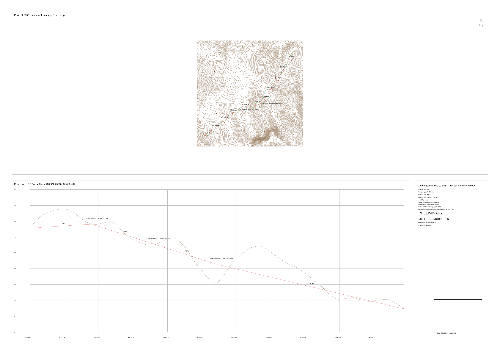

# civil-mcp

Agent-native road design tools in the spirit of Civil 3D: survey points → TIN surface → horizontal alignment + vertical profile with design-standard checks → cut/fill earthwork → plan/profile sheet (DXF + PDF) → review report. Every operation is an MCP tool, every design decision goes into a hash-chained audit log with the cited rule, and nothing is marked anything other than **PRELIMINARY – NOT FOR CONSTRUCTION** until an engineer records an approval.

**This is not a substitute for a licensed engineer.** It is a tool an engineer in responsible charge can direct and check. See [Why the engineer comes first](#why-the-engineer-comes-first).



## Try it (offline, one command)

```bash
cargo run --release -p civil-demo
```

Uses the bundled USGS 3DEP terrain sample (see [data/SOURCE.md](data/SOURCE.md)). It writes `demo-out/` with `audit.jsonl`, `earthwork.json`, `model.dxf` (world coordinates), `sheet.dxf` + `sheet.pdf` (A1 plan/profile sheet) and `review.html`. Committed copies: [docs/sheet.pdf](docs/sheet.pdf), [docs/review.html](docs/review.html), [docs/audit-sample.jsonl](docs/audit-sample.jsonl).

The demo shows the intended loop: the agent drafts a profile with 20 m vertical curves, `check_standards` reports 3 mandatory failures, the agent asks `suggest_profile` for a standards-driven proposal, adopts it, and the checks pass (19/19). Both attempts stay in the audit log.

## Use it from an MCP client

```bash
cargo build --release
# e.g. Claude Code
claude mcp add civil -- /path/to/civil-mcp/target/release/civil-mcp
```

stdio, JSON-RPC 2.0. Tools:

| Tool | What it does |
|---|---|
| `open_project` | Opens a project folder; verifies the existing audit log |
| `set_design_basis` | Engineer sets standard, design speed, limits. Refused unless `actor` is `engineer:<name>`. All design tools refuse to run before this. |
| `load_points` | CSV (`id,easting,northing,elevation,desc`) or LandXML `CgPoint`s; rejected rows are listed |
| `build_surface` | Delaunay TIN, optional max triangle edge |
| `create_alignment` | Tangent–circular-curve–tangent from PIs and radii; rejects overlapping curves |
| `sample_ground_profile` | Ground along the alignment |
| `suggest_profile` | Proposes VPIs, clamps grades to the max, sizes vertical curves to the minimum required |
| `create_profile` | VPIs + parabolic vertical curves |
| `check_standards` | Every check returns value, limit, formula and citation |
| `compute_earthwork` | Cross sections with daylighting side slopes, average-end-area volumes |
| `generate_drawings` | `model.dxf`, `sheet.dxf`, `sheet.pdf` |
| `generate_review_report` | `review.html`: checks, earthwork, file hashes, full audit trail |
| `record_review` | Engineer approve / reject / comment. Approve is refused while any mandatory check fails. |
| `verify_audit_log` | Recomputes the hash chain, reports the first altered line |

Each result includes a `provenance` record (`audit_seq`, `entry_hash`, `inputs_sha256`, `tool_version`, `rules`).

## Standards implemented

- **JTG D20-2017** (China, 公路路线设计规范), design speeds 120/100/80/60/40/30/20 km/h: minimum circular curve radius (limit = mandatory, general = advisory), maximum grade, minimum grade length, minimum crest/sag vertical curve radius, minimum vertical curve length. Values are table lookups transcribed into [`standards.rs`](crates/civil-core/src/standards.rs).
- **AASHTO Green Book 2018** (metric): stopping sight distance `0.278·V·t + 0.039·V²/a`, minimum radius `V²/(127(e+f))`, crest (`A·S²/658`) and sag headlight (`A·S²/(120+3.5S)`) curve lengths for both S<L and S>L cases. `e_max`, `f_max` and max grade must be supplied by the engineer, because they depend on facility type, terrain and climate.

The table values and formulas were transcribed by the author of this tool. **The engineer must verify them against the edition and clause numbers they work to.** Not implemented: spirals, superelevation, horizontal sight distance, intersections, drainage, pavement, local agency standards.

## Validation (measured, demo project)

Terrain: USGS 3DEP, about 895 × 895 m of foothills near Palo Alto, CA, elevations 57–163 m. 5,607 random raster cells were used as stand-in survey points. TIN: 11,089 triangles. Road: 1,087.9 m, two curves (R 150 m, R 120 m), JTG D20-2017 at 40 km/h, 9 m crowned template, 1.5H:1V slopes.

Earthwork, Rust average end area at 10 m stations compared with an independent Python grid method ([`scripts/independent_check.py`](scripts/independent_check.py): no Rust code, Qhull triangulation via SciPy). The check runs in CI.

| Method | Cut m³ | Fill m³ | Rust vs this, cut / fill |
|---|---:|---:|---:|
| Rust, average end area, 10 m | 127,513 | 22,543 | — |
| Grid 1.0 m, same points (Qhull TIN) | 127,629 | 22,169 | −0.09% / +1.68% |
| Grid 0.5 m, same points (Qhull TIN) | 127,614 | 22,204 | −0.08% / +1.52% |
| Grid 0.5 m, full raster DEM (bilinear, 40,000 cells) | 129,959 | 23,049 | −1.88% / −2.20% |

Caveats: the grid check reuses the Rust daylight offsets to bound the footprint, so it does not independently test daylighting. The raster row also measures how much ground was lost by sampling 5,607 of 40,000 cells. Average end area has no curvature correction.

Other checks:
- Unit tests cover a planar TIN reproduced exactly, curve geometry against closed form, the vertical parabola against closed form, a fill prism against a hand calculation (28 m²/section, 14,000 m³), SSD at 80 km/h (129.0 m; the Green Book tabulates 130 m rounded), and audit tampering detection.
- An integration test drives the real binary over stdio. It checks that the agent cannot set the basis, that design is refused before a basis exists, that R = 100 m fails JTG at 60 km/h, and that approval is refused while checks fail.
- Both DXFs pass `ezdxf` recover + audit with 0 errors and 0 fixes (CI). The PDF parses with `pypdf` (CI). I have not opened them in AutoCAD or Civil 3D.

## Why the engineer comes first

US boards require the sealing engineer to be in **responsible charge** (e.g. North Carolina 21 NCAC 56.0701; Florida FBPE). NSPE's 2025 BER discussion of AI says that "reviewing drawings or documents after preparation without involvement in the design and development process does not satisfy the definition of Responsible Charge." In China, design documents take effect only once the registered engineer signs and stamps them (勘察设计注册工程师管理规定 第二十条), and they are subject to plan review against mandatory standards.

So the design is: the engineer sets the basis first, the agent works inside it, every decision is logged with its rule, the engineer reviews the checks and the trail, and only the engineer approves and seals. MCP cannot authenticate a human, and `actor: engineer:<name>` is a declaration, not proof of identity. Deployments need real authentication in front of `set_design_basis` and `record_review`.

## Geometry kernel

Civil work at this stage is TIN math and 2D/3D alignment math, so there is no B-rep kernel. Triangulation uses [`delaunator`](https://crates.io/crates/delaunator) (ISC). Everything else is in this repo. A permissive kernel ([truck](https://github.com/ricosjp/truck), [solidcore](https://github.com/tangency-labs/solidcore), or NVIDIA [usd-brep](https://github.com/NVIDIA-Omniverse/usd-brep), all Apache-2.0) becomes useful for structures, retaining walls and pipe solids. No GPL/LGPL code (OpenCASCADE, FreeCAD, SolveSpace) was read or used.

## Limits

- Simple template only: crowned lanes plus daylight cut/fill slopes. No subassemblies, ditches, curbs, superelevation or widening.
- Horizontal geometry is circular curves only (no spirals). Vertical geometry is symmetric parabolas only.
- LandXML import is `CgPoint`s only. No LandXML surface or alignment import/export yet, and no DWG.
- Sheet text is ASCII (Chinese labels show as `?` in DXF/PDF).
- Tested on one public terrain sample. No comparison against Civil 3D quantities yet.

## License

Apache-2.0
