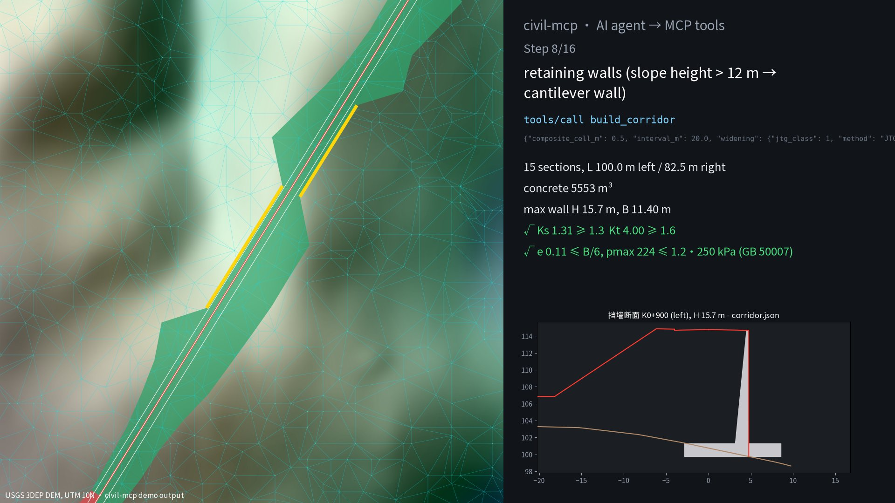
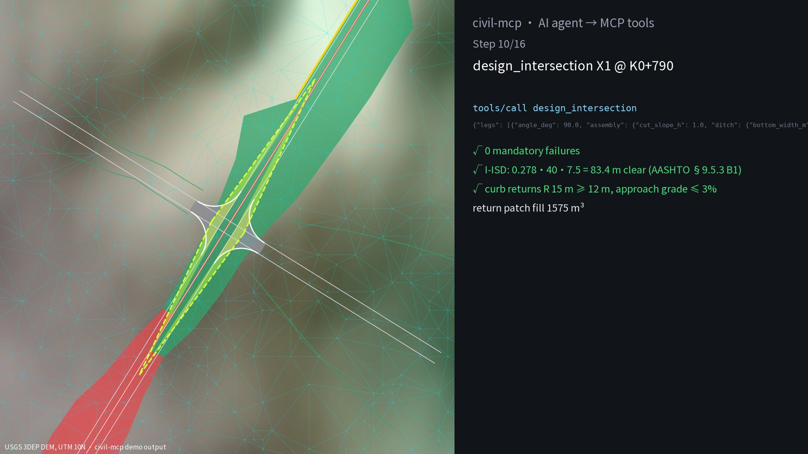
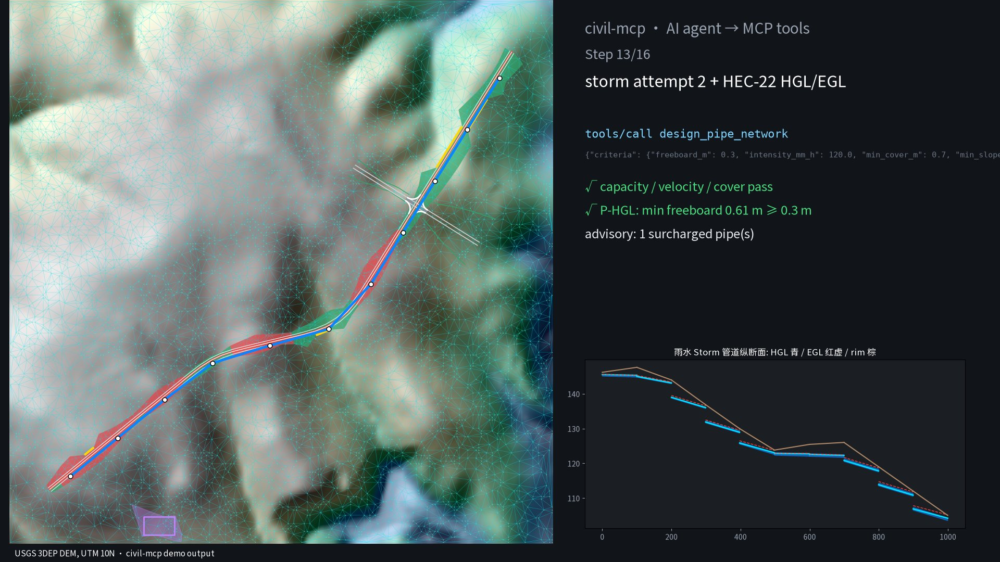
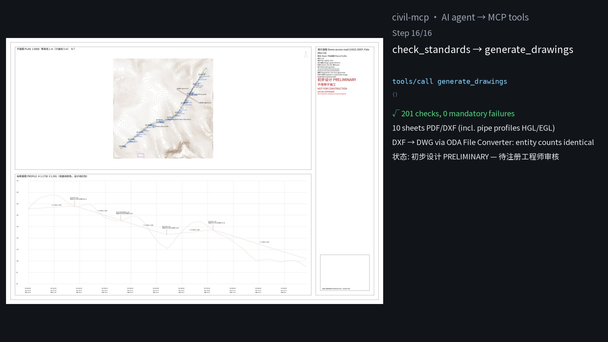

# civil-mcp

Agent-native road and site design tools in the spirit of Civil 3D, exposed as MCP tools: survey points → TIN → alignment with clothoid spirals → superelevation → profile → assembly/corridor (asymmetric sides, curbs/gutters/sidewalks, curve widening, ditches, benched slopes, retaining walls with stability checks) → at-grade intersections (curb returns, sight triangles, tie-in) → pad grading → storm and sanitary networks with HGL/EGL → mass haul and material tables → plan/profile, cross-section and quantity sheets (PDF + DXF, Chinese text) → LandXML 1.2 export → review report. Every call goes into a hash-chained audit log with the rule it applied. Nothing is marked anything other than **初步设计 PRELIMINARY – NOT FOR CONSTRUCTION** until an engineer records an approval, and any later design change voids that approval.

**This is not a substitute for a licensed engineer.** It is a tool that an engineer in responsible charge directs and checks. See [Why the engineer comes first](#why-the-engineer-comes-first).


*Every frame above is drawn from files the tools wrote during `cargo run -p civil-demo` (`run-log.jsonl`, `design.xml`, `corridor.json`, `network-*.json`, `intersection-X1.json`, …) by [`scripts/animate.py`](scripts/animate.py). Red/green = cut/fill footprint, yellow = retaining walls. The failed attempts are real: the first spiral length, the first intersection location, the first storm sizing and the first two sanitary attempts all fail mandatory checks, and each is revised. MP4 (1080p): [docs/media/civil-mcp-agent-design.mp4](docs/media/civil-mcp-agent-design.mp4).*

## Try it (offline, one command)

```bash
cargo run --release -p civil-demo
```

Uses the bundled USGS 3DEP sample ([data/SOURCE.md](data/SOURCE.md)) and writes `demo-out/`. Committed copies: [sheets.pdf](docs/sheets.pdf) (10 sheets), [review.html](docs/review.html), [design.xml](docs/design.xml) (LandXML 1.2), [run-log.jsonl](docs/run-log.jsonl).

What the demo does (JTG D20-2017, 40 km/h, e_max 0.08, μ 0.04, all set by the "engineer" step):

1. 5,607 points → TIN with 11,089 triangles.
2. Alignment with two curves (R 150 m, R 120 m) and 40 m clothoids. `check_standards` fails `SE-IN-LS` on curve 2: the superelevation transition needs 44.6 m, but the spiral is only 40 m. The agent lengthens the spirals to 50 m and the check passes.
3. Profile from `suggest_profile`; geometry checks pass.
4. Assembly: 2 × 3.5 m lanes and three pavement layers. Left side: 0.75 m shoulder, ditch in cut, 1:1 / 1:1.5 slopes with 2 m benches. Right side: 0.5 m gutter + 0.15 m curb + 2 m sidewalk (no ditch). JTG class-1 curve widening: 0.6 m at R 150 and 0.8 m at R 120 (表 7.6.1), applied on the inside lane and run out over the spirals. Wall rule: a cantilever wall wherever the slope would be taller than 12 m or go beyond 30 m. The corridor has 70 sections; cut is 57,602 m³ and fill is 69,289 m³ (the composite grid gives +0.55 % / +0.20 %). Walls: 15 sections, 100 m left + 82.5 m right, 5,553 m³ of concrete, H up to 15.7 m. Every wall passes sliding ≥ 1.3, overturning ≥ 1.6, e ≤ B/6 and p_max ≤ 1.2 f_a (GB 50007-2011).
5. Intersection X1 (two minor legs, 15 m curb returns). At K0+700 it fails `I-ISD` twice: the cut slope blocks the AASHTO Case B1 sight line by 1.20 and 1.21 m. Moved to K0+790, all 10 checks pass. Moving it was the agent's choice; an engineer must confirm it.
6. A 50 × 30 m yard pad graded to the ground at 2:1.
7. Storm sewer (GB 50014-2021). Attempt 1 fails 8 checks, attempt 2 passes. The HEC-22 HGL is then ≥ 0.61 m below every rim (0.3 m required); 1 pipe is surcharged (advisory).
8. Sanitary sewer (200 people per manhole, 200 L/d, GB Kz). Attempt 1 fails 4 × `P-VMIN` and attempt 2 (1.2 % minimum slope) fails 1. Attempt 3, with a 2 % head reach, passes.
9. Mass haul (cut factor 0.9): final ordinate −17,447 m³ (import needed), balance point K0+953.6.
10. Drawings (plan with walls, curbs, returns and sight triangles; cross-sections with walls; pipe profiles with HGL/EGL), LandXML export (XSD-valid, with both pipe networks), review report. 201 checks, 0 mandatory failures, 1 advisory, status PRELIMINARY.

| | |
|---|---|
|  |  |
|  |  |

## Use it from an MCP client

```bash
cargo build --release
claude mcp add civil -- /path/to/civil-mcp/target/release/civil-mcp   # e.g. Claude Code
```

stdio, JSON-RPC 2.0. Tools: `open_project`, `set_design_basis`, `load_points`, `import_landxml`, `export_landxml`, `build_surface`, `create_alignment`, `sample_ground_profile`, `suggest_profile`, `create_profile`, `design_superelevation`, `check_standards`, `create_assembly`, `build_corridor`, `get_section`, `design_intersection`, `grade`, `design_pipe_network`, `compute_quantities`, `generate_drawings`, `generate_review_report`, `record_review`, `verify_audit_log`, `get_state`. Each result carries a `provenance` record (`audit_seq`, `entry_hash`, `inputs_sha256`, `rules`).

## What is implemented

- **Alignment**: tangents, circular arcs, and symmetric clothoids (spiral–curve–spiral, Ts = (R+p)·tan(Δ/2)+k). The clothoid is integrated numerically (Gauss–Legendre). Overlapping curves are rejected and never silently adjusted.
- **Superelevation**: rotation about the centreline. AASHTO Method 1 (e = e_max·R_min/R, relative-gradient table) or JTG (i = V²/127R − μ, no-superelevation radius table, transition gradient 1/p). Checks that the transition fits inside the spiral.
- **Standards**: JTG D20-2017 (radius limit/general, max grade, min grade length, crest/sag radius, VC length, stopping sight distance table, min spiral length) and AASHTO 2018 (SSD formula, min radius, crest/sag K, spiral length range). e_max and f/μ are always engineer inputs.
- **Corridor**: assemblies (lanes, shoulder, ditch in cut, cut/fill slopes with benches, pavement layers with a subgrade datum), daylighting by ray-walk plus bisection, sections at stations and key points, average-end-area volumes cross-checked by a composite grid volume, and FG/datum surfaces.
- **Asymmetric sections, curbs, widening**: per-side overrides (lanes, shoulder, slopes, ditch, wall, `remove`). Curb = gutter + curb face + sidewalk; in cut the subgrade datum steps up at the paved edge. Widening is from JTG D20-2017 表 7.6.1 (3 vehicle classes) or AASHTO 2018 §3.3.10 (w_c = N(U+C) + (N−1)F_A + Z); it is full over the arc and linear over the spirals.
- **Retaining walls**: placed where the slope exceeds a height or ROW limit. Cantilever or gravity; Rankine K_a with surcharge; moments about the toe. The base width is the smallest (0.05 m steps) that passes sliding, overturning, eccentricity and bearing: GB 50007-2011 §6.7.5/§5.2.1 (1.3 / 1.6 / 1.2 f_a) or AASHTO Std Spec 17th §5.5.5 (1.5 / 2.0). There is no global stability, seismic or structural (reinforcement) design.
- **At-grade intersections**: T or 4-leg, any skew. Curb returns are fillets tangent to the main and leg edges. The leg profile ties to the main-road FG at its edge. The return patch surface and volume are computed. Sight triangles follow AASHTO 2018 §9.5.3 Case B1 (ISD = 0.278·V·t_g, eye 4.4 m back, 1.08 m eye/object height), with the line of sight tested against corridor FG / EG. Checks: `I-RETURN`, `I-GRADE`, `I-ISD`.
- **Grading**: feature line or pad offset at a slope to the surface (mitred corners), with composite volume.
- **Pipes**: dendritic gravity storm or sanitary networks; inverts from min cover, slope and drop; optional per-pipe min/max slope. Manning full and partial flow, rational method, sanitary Q = K_z·Q_avg (GB 50014-2021 table) with min DN300. HGL/EGL by the FHWA HEC-22 approximate method: outfall at max(tailwater, (d_c+D)/2), friction slope when full, normal depth when partial, structure loss K·V²/2g with K by deflection. Checks: HGL ≤ rim − freeboard (mandatory) and surcharge (advisory). Pipe profile sheets show HGL/EGL. LandXML read/write of `PipeNetworks`.
- **Quantities**: mass haul ordinates, balance points, haul moment, and a material table by station range (cut, fill, pavement layers).
- **Drawings**: PDF with an embedded, subsetted CJK font (Noto Sans SC, OFL, bundled), and DXF R12 with a `CJK` text style (`$DWGCODEPAGE ANSI_936`). Plan/profile (walls, curbs, returns, sight triangles), cross-section sheets (12 per sheet, walls drawn), a pipe profile per network, and a mass-haul/material sheet. The sheets convert to DWG with ODA File Converter, and the round trip is checked (see Validation). The title block stamp switches from PRELIMINARY only when the audit log holds an engineer approval and 0 mandatory failures.
- **LandXML 1.2**: read and write CgPoints, TIN surfaces, alignments (Line/Curve/Spiral), and profiles (PVI/ParaCurve).

The table values and formulas were transcribed by the author of this tool. **The engineer must verify them against the edition and clause they work to.**

## Validation (all numbers measured; see [docs/VALIDATION.md](docs/VALIDATION.md))

- `cargo test`: unit tests (clothoid vs series, spiral-curve-spiral closure, square pad vs exact prismoid formula (tolerance 0.5 %), Manning textbook case, ditch/bench section hand calc, …), a LandXML round-trip, a Civil 3D LandXML fixture, a stdio MCP test, and a full-pipeline test (including: the agent cannot approve, approval works only with 0 failures, a later design change voids it, and the audit chain verifies).
- [`scripts/independent_check.py`](scripts/independent_check.py) (no shared code, runs in CI) has 50 checks on the demo output, all OK:
  - section areas within 0.042 %; corridor volumes within 0.004 %; mass haul exact;
  - superelevation, clothoids (vs SciPy Fresnel < 1e-6 m), Manning / partial flow / GB K_z: exact or < 1e-9;
  - a second HGL/EGL implementation matches to 0 m;
  - wall FS / e / p_max re-derived from polygon centroids and a numerically integrated pressure, < 1e-8;
  - JTG widening table, ISD, return tangency (< 1e-9 m); return-patch volume within 0.57 %;
  - LandXML XSD-valid; DXF audit clean and units correct.
- **Civil 3D LandXML files**:
  - The TIN 2D/3D areas match Civil 3D's to ≤ 1e-12 relative (6 surfaces), and a 23.47 km alignment rebuilds within 2.6e-10 m.
  - **Civil 3D 2025 pipe networks** (3 files, 411 pipes): pipe 3D length matches to ≤ 1.3e-9 m, including 6 curved pipes, and slope to ≤ 5.6e-8.
  - No public Civil 3D corridor volumes or analysed pipe hydraulics (the files carry `flowIn=0`) were found to compare against. What was tried is listed in VALIDATION.md.
- **DWG**: all 11 DXFs convert to AutoCAD 2018 DWG with ODA File Converter (with audit). The DWG → DXF round trip keeps the per-layer entity counts and coordinates. LibreDWG reads the DWGs, and LibreCAD renders the DXFs; this found a units bug, now fixed.

## Why the engineer comes first

US boards require the sealing engineer to be in **responsible charge** (e.g. North Carolina 21 NCAC 56.0701; Florida FBPE). NSPE's 2025 BER discussion of AI says that "reviewing drawings or documents after preparation without involvement in the design and development process does not satisfy the definition of Responsible Charge." In China, design documents take effect only once the registered engineer signs and stamps them (勘察设计注册工程师管理规定 第二十条), and they are subject to plan review against mandatory standards.

So the design is: the engineer sets the basis first, the agent works inside it, every decision is logged with its rule, the engineer reviews the checks and the trail, and only the engineer approves and seals. MCP cannot authenticate a human, and `actor: engineer:<name>` is a declaration, not proof of identity. Deployments need real authentication in front of `set_design_basis` and `record_review`.

## Geometry kernel

Civil work at this stage is TIN math and 2D/3D alignment math, so there is no B-rep kernel. Triangulation uses [`delaunator`](https://crates.io/crates/delaunator) (ISC). Everything else is in this repo. Walls are 2D sections (stability is per metre run), so a B-rep kernel was not needed for them. A permissive kernel ([truck](https://github.com/ricosjp/truck), [solidcore](https://github.com/tangency-labs/solidcore), or NVIDIA [usd-brep](https://github.com/NVIDIA-Omniverse/usd-brep), all Apache-2.0) becomes useful for 3D wall/structure solids and clash checks. No GPL/LGPL code (OpenCASCADE, FreeCAD, SolveSpace) was read or used.

## Limits

- Not compared against Civil 3D corridor volumes or Civil 3D pipe hydraulics: no public dataset with those results was reachable (see VALIDATION.md for what was tried). Civil 3D pipe *geometry* (length, slope) and surfaces/alignments were compared.
- HGL/EGL uses the HEC-22 *approximate* method (no bend/junction/plunge-specific coefficients from the energy-loss method, no inlet control, no unsteady flow). The K values were transcribed and must be verified.
- Walls: Rankine, level backfill, no passive resistance, no global (slip-circle) stability, seismic, drainage or reinforcement design. Bearing uses a single allowable value. Wall placement is per section; there are no wall ends, returns or steps.
- Intersections: straight legs only, no channelisation, turn lanes, islands or roundabouts, and no swept-path analysis. Curb return radii are an engineer input. Sight lines are tested against terrain and the corridor only (no buildings or vegetation).
- Average end area has no curvature correction. Grading uses mitred offsets only. Networks are dendritic gravity only (no pumping or pressure).
- DWG comes from the proprietary ODA converter (not bundled). Not opened in AutoCAD/Civil 3D. DXF is R12.
- Standards tables were transcribed by hand and must be verified. The design basis "engineer" in the demo is a placeholder, and nothing here has been reviewed by a licensed engineer. Tested on one public terrain sample.

## License

Apache-2.0. Bundled font: Noto Sans SC (SIL OFL 1.1, `crates/civil-core/assets/OFL.txt`). Test fixture `c3dprofile2.xml`: MIT (RustedGeom/rusted-geom).
