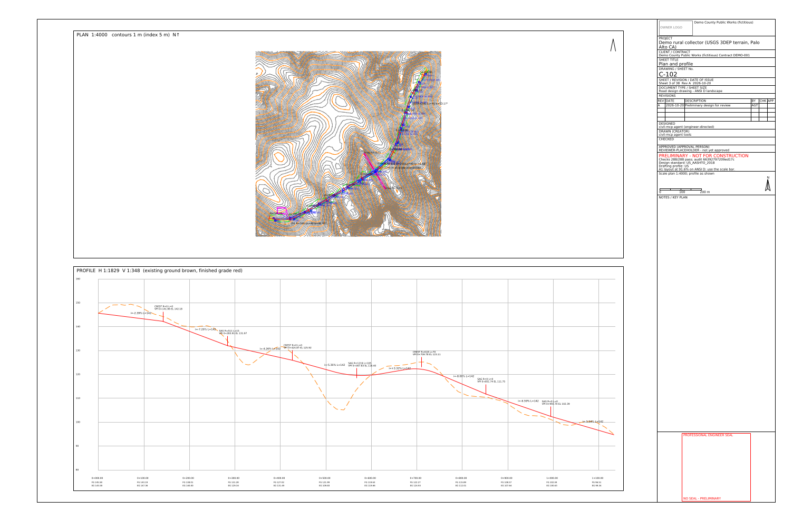
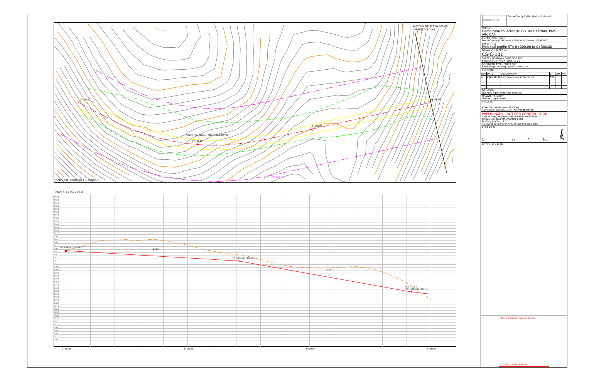

# Interoperability tests (substitute CAD software)

Run on 2026-10-20 (PDT) on a Debian 13 Linux box. **These are substitutes for Civil 3D and 12d. Nothing here has been opened in Civil 3D, AutoCAD or 12d.**

## ODA File Converter: DXF → DWG → DXF

- Converter: ODA File Converter 27.9.0.0 (Linux AppImage, free download from <https://www.opendesign.com/guestfiles/oda_file_converter>), run headless under `xvfb-run`, audit flag on.
- Input: the 53 DXF files of the demo run: `sheet-01` … `sheet-38`, `cs-01` … `cs-14` and `civil3d-model.dxf` (DXF R12 / AC1009 as written by civil-mcp).
- Output: DWG in two versions, **AC1027 (AutoCAD 2013)** and **AC1032 (AutoCAD 2018)**, version magic checked in each file header. The DWG files were then converted back to DXF with the same tool.
- Comparison: [`scripts/dwg_compare.py`](../scripts/dwg_compare.py) reads the original DXF and the read-back DXF with ezdxf and compares modelspace entity counts by type, the polyline vertex total, the set of layers that carry entities, and the drawing extents.

| DWG version | Files | Entities compared | Count / layer / extents mismatches | ezdxf audit errors (before / after) |
|---|---:|---:|---:|---|
| AC1027 (2013) | 53 | 164,122 | **0** | 0 / 0 |
| AC1032 (2018) | 53 | 164,122 | **0** | 0 / 0 |

One expected change: ODA writes the R12 2D `POLYLINE` entities back as `LWPOLYLINE` (the DWG-era form of the same geometry). The script counts both as a 2D polyline and compares the vertex totals, which match. Extents match to 0. The `civil3d-model.dxf` 3D model (12,763 entities on 7 layers, including 12,691 3D faces) survives both versions unchanged.

Per-file results: [dwg-compare-AC1027.txt](interop/dwg-compare-AC1027.txt), [dwg-compare-AC1032.txt](interop/dwg-compare-AC1032.txt).

Sheet 3 and construction sheet CS-C-101, drawn with ezdxf from the DXF read back out of the AC1032 DWG:

### DWG from the tool

`export_cad_model` takes `dwg_version` (`ACAD2004`, `ACAD2007`, `ACAD2010`, `ACAD2013`, `ACAD2018`) and `dwg_include_sheets`. When ODA File Converter is installed (`ODA_FILE_CONVERTER=/path/to/ODAFileConverter` or `ODAFileConverter` on PATH) the model, and optionally every `sheet-NN` / `cs-NN` DXF, is converted into `dwg/` and each DWG is hashed into the audit log. Without the converter the call returns an error that says what to install. ODA File Converter is a separate program under ODA's own terms; it is not bundled. The test `crates/civil-demo/tests/dwg.rs` covers both cases (CI runs the no-converter case).

## BricsCAD (Linux trial)

Not installed. The download at <https://bricscad.octave.com/cad-download> requires signing in with a Bricsys account before the Linux `.deb` can be downloaded. The trial itself is 30 days, no credit card. Release notes state that V27 needs Ubuntu 24.04 or a distribution newer than April 2024, and that civil TIN surfaces and alignments need the Pro level or higher (the trial runs as Ultimate). LandXML import in BricsCAD has therefore not been tried.
